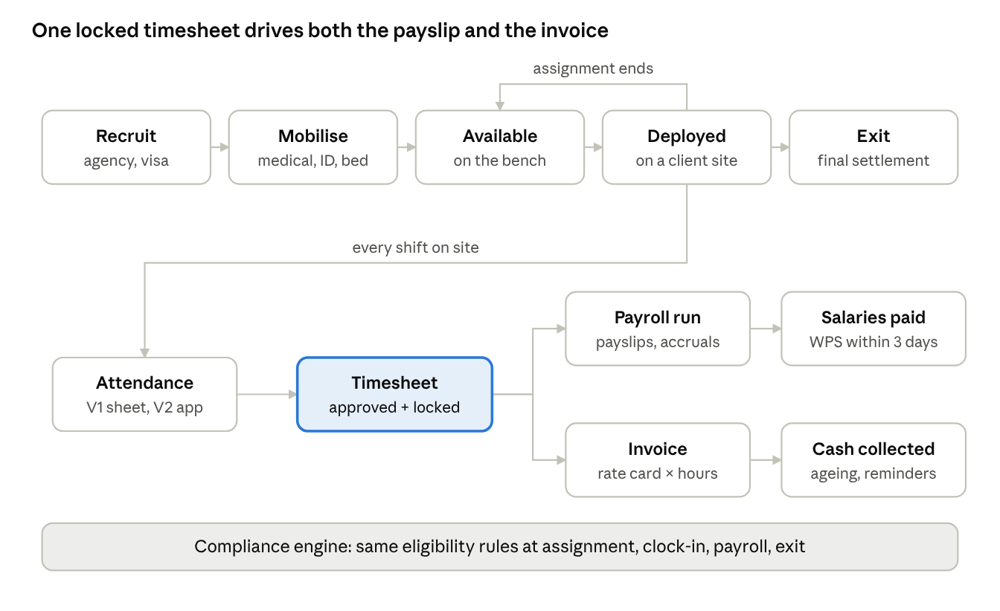
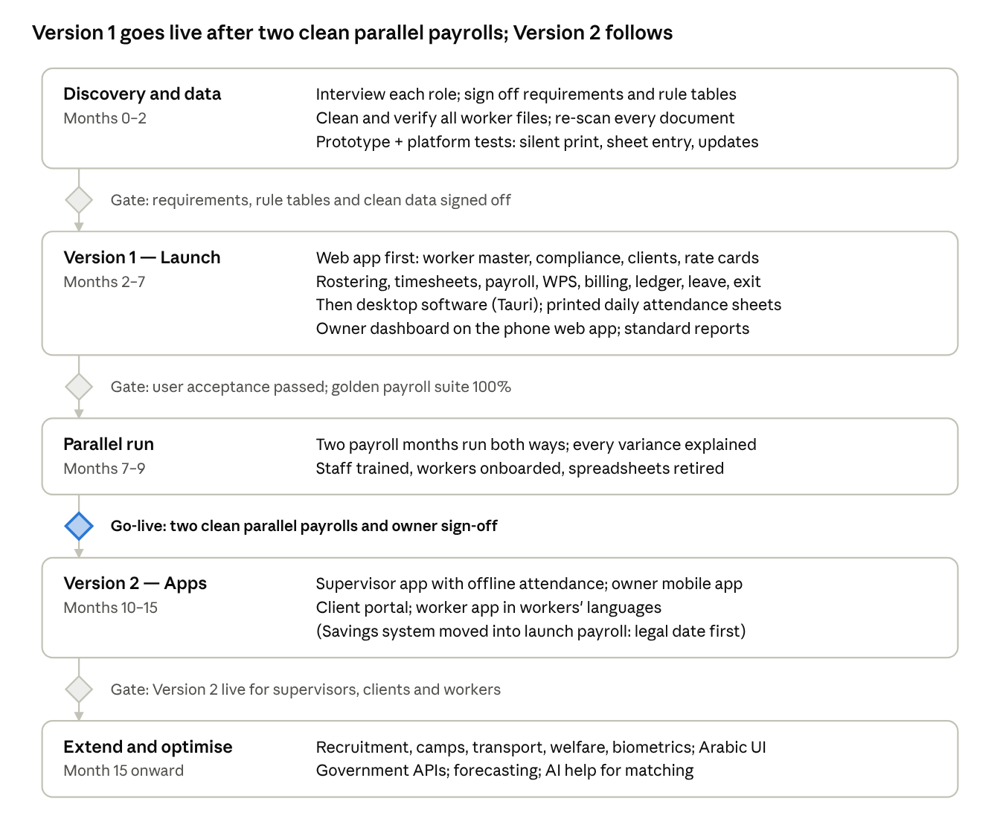

# Manpower Management System — PRD

2026-10-12 · sami

## 1. Overview

One system of record that follows every worker from recruitment abroad to final settlement, every client from quote to collected invoice, and every hour from the site to the payslip — so a 700-worker company runs on 15–25 office staff without spreadsheets, WhatsApp chasing or compliance surprises.

"Do not compromise" is defined here as five non-negotiables that every design decision is tested against:

1. **Zero lapsed documents.** No worker is ever deployed or paid with an expired visa, labour card, passport or medical — the system blocks it, not a person.
2. **Pay is right, on time, every month.** WPS file generated, validated and submitted before the deadline; every baisa traceable from timesheet to payslip.
3. **Every billable hour is billed.** Hours worked flow to client invoices automatically; unbilled hours are a visible, daily number.
4. **Workers are kept informed.** Every worker gets their payslip, roster changes and document-expiry reminders by WhatsApp or SMS, plus a printed payslip; a full worker app comes in Version 2.
5. **Owner sees the business in one screen.** Headcount, deployment rate, margin per client, cash, and compliance risk — live, on a phone.

### Working assumptions

These drive the design; change any of them and the affected sections change with it.

| Area | Assumption |
|---|---|
| Business model | Labour supply / outsourcing: the company sponsors and employs the workers, deploys them to client sites, and bills clients per hour, day or month |
| Jurisdiction | Oman first (Sohar / Muscat); Oman only today (confirmed). Data model stays multi-entity so a UAE or other GCC entity can be added later without a rewrite |
| Workforce | ~650–700 workers, mostly expatriate blue-collar construction workers (confirmed): labourers and skilled trades such as masons, carpenters, steel fixers, electricians and operators, growth headroom to 2,000 |
| Office users | 15–25 office staff across HR/PRO, operations, payroll and finance, plus the owner/GM and a system admin, all in Version 1. Site supervisors, client contacts and workers get their own apps in Version 2 |
| Clients | Many active clients (count measured in Discovery), each with one or more sites and contracts; sized for 200+ clients and 500+ sites |
| Currency | OMR with 3 decimal places (baisa); multi-currency for recruitment-agency costs abroad (BDT, INR, NPR, PKR) |
| Languages | English only at launch. Arabic (right-to-left) and workers' languages come later; all text is kept in translation files so adding them needs no redesign |
| Hosting | AWS (client decision), in an AWS Middle East region approved after a PDPL cross-border transfer assessment |
| Product shape | One shared interface. Version 1: the Tauri desktop app for office staff and the admin, and the web app (phone-ready) for the owner and as a fallback. Version 2 adds a Capacitor mobile app for supervisors, workers and the owner, and a web portal for clients |

### Release scope: Version 1 and Version 2

The product ships in two versions. Version 1 is everything the office, the owner and the system admin need to run the company. Version 2 adds the apps for the people outside the office.

| Area | Version 1 (go-live 8 Aug 2027) | Version 2 (by 27 Jan 2028) |
|---|---|---|
| Who signs in | HR/PRO, operations, payroll, finance, owner/GM, system admin | Adds site supervisors, client contacts and workers |
| Front doors | Tauri desktop app for the office and admin; the web app in any browser, phone-ready for the owner | Capacitor mobile app (supervisor, worker and owner modes); client web portal |
| Modules | Every launch module in section 4 except 4.13–4.15 | Worker app (4.13), supervisor app (4.14), client portal (4.15) |
| Attendance | A printed daily sheet per site, pre-filled from the roster, marked and signed by the supervisor, then entered and checked in the office with its scan filed | The supervisor marks the crew on the phone, offline; the sheet is retired site by site |
| Timesheet approval | Checked in operations by a second person, then signed by the client on an emailed timesheet pack (or auto-approved per contract) | The supervisor approves in the app; the client approves in the portal |
| Workers | Payslips, reminders and roster changes by WhatsApp/SMS; printed payslips; HR records their requests | Worker app in their own languages |

Nothing in Version 1 is a stopgap that Version 2 throws away. The server, API, data model and permissions are built for all nine roles from the start; attendance from a sheet and from the app lands in the same records; Version 2 adds front doors, not a rebuild. In section 4, P1 means Version 1 except where a module says Version 2, and P2 and P3 items follow after Version 2.

This document has two parts: this PRD (what the product must do and why) and the Technical Spec tab (how it is built).

## 2. Problem, goals and success metrics

A manpower company's margin leaks in four places: workers who sit idle between deployments, hours worked but never billed, fines and blocked visas from lapsed documents, and office time spent re-keying the same data into spreadsheets, bank files and government portals. The system exists to close all four.

### Problems today (typical for a company this size)

- Worker data lives in Excel, paper files and staff memory; nobody can answer "who is available tomorrow with a valid driving licence?" in under a minute.
- Document expiries are tracked by hand, so renewals are rushed, late fees are paid and workers are stuck unable to travel or work.
- Timesheets come from sites on paper or WhatsApp photos and are typed in twice — once for payroll, once for invoicing — with disputes on both sides.
- Payroll, WPS files, end-of-service and leave balances are computed in spreadsheets that one person understands.
- The owner gets numbers weeks late and cannot see profit per client, per site or per worker.
- Workers have no self-service: every payslip question, leave request or advance becomes a phone call or a visit.

### Goals and targets (12 months after go-live)

| Goal | Metric | Target |
|---|---|---|
| No compliance lapses | Workers with an expired mandatory document while deployed | 0 |
| No compliance lapses | Renewals started ≥ 60 days before expiry | ≥ 95% |
| Pay right and on time | Salaries paid through WPS by the legal deadline | 100% of months |
| Pay right and on time | Payroll corrections after release | < 0.5% of payslips |
| Bill every hour | Approved hours invoiced within 5 days of period close | ≥ 98% |
| Bill every hour | Days sales outstanding (DSO) | Down 25% from baseline |
| Keep workers earning | Bench rate (available, valid, not deployed) | < 5% of headcount |
| Faster close | Payroll + invoicing cycle, period end to release | ≤ 3 working days |
| Office efficiency | Workers managed per office FTE | ≥ 40 |
| Adoption | Payslips delivered digitally (WhatsApp/SMS) | ≥ 80% |
| Adoption | Timesheets captured digitally at source | ≥ 95% |

Baselines are measured in the first month of discovery; the targets above are the bar the project is judged against.

## 3. Users, roles and personas

Nine roles cover everyone who touches the system; each sees only what their job needs, and every screen is designed for the device that role actually carries.

| Role | Approx. users | Main device | What they do in the system | Sees |
|---|---|---|---|---|
| Owner / GM | 1–3 | Phone, tablet | Reads the executive dashboard, approves big decisions (new contracts, write-offs, salary changes above a threshold) | Everything, read-mostly |
| Operations manager | 2–4 | Laptop, phone | Matches workers to client orders, manages rosters, transfers and bench | All workers, all clients, no salary detail beyond cost rate |
| HR / PRO officer | 3–5 | Laptop | Recruitment, visas, labour cards, medicals, renewals, contracts, exits | Worker files and documents |
| Payroll officer | 1–2 | Laptop | Runs payroll, WPS, advances, deductions, EOSB, leave pay | Pay data, timesheets |
| Accountant / finance | 1–3 | Laptop | Invoicing, receivables, credit control, posting to accounts | Invoices, receipts, costs |
| Site supervisor / foreman | 20–40 | Android phone | Version 1: marks and signs the printed daily attendance sheet and sends a photo to the office. Version 2: takes attendance, approves timesheets, reports incidents and handles worker requests in the app | Only their crew and site |
| Worker | 650–700 | WhatsApp / SMS (app in Version 2) | Sees roster, payslip, documents, leave balance; raises requests; clocks in where enabled | Only their own record |
| Client contact | 20–80 | Laptop, phone | Version 1: signs the emailed timesheet pack and receives invoices by email. Version 2: approves timesheets, places manpower requests and downloads invoices in the portal | Only their sites, workers and invoices |
| System admin | 1 | Laptop | Users, roles, settings, rule tables, integrations | Configuration and audit |

### Personas that shape the design

- **Rahim, construction labourer (worker).** Reads Bengali, little English, shares a phone with his room-mate some months. Needs: his payslip in Bengali with every deduction explained, a way to ask for leave or an advance without visiting the office, and a reminder when his labour card renewal needs his photo or signature. Design rule until the worker app arrives in Version 2: his payslip and reminders reach him by WhatsApp, and his supervisor logs any request for him in the supervisor app.
- **Ahmed, site supervisor.** Runs 35 workers across two shifts. Needs: one-tap crew attendance that works offline in a basement, quick swaps when someone is sick, and no paperwork at month end. Design rule for Version 1: a printed sheet already filled with his crew, so he only marks exceptions and signs. For the Version 2 app: the whole crew on one screen, bulk actions, offline-first.
- **Fatima, HR/PRO officer.** Owns 700 files and their renewals. Needs: a morning to-do list of what expires, what is waiting on government, and what is waiting on the worker. Design rule: work queues, not reports.
- **The owner.** Works mostly by phone and WhatsApp. Needs: five numbers that say whether the business is healthy, with the ability to tap any number and see the names behind it, plus approvals he can do from a message. Design rule: phone-first dashboard, approvals from a WhatsApp or email link that opens on his phone (push notifications arrive with the Version 2 mobile app), no training required.

## 4. Functional requirements by module

Seventeen modules share one worker record, one client record and one ledger of hours — nothing is typed twice. P1 = Version 1 (launch) unless a module is marked Version 2; P2 = after Version 2; P3 = later (see Release plan).

### 4.1 Worker master and document vault — P1

- One profile per worker: identity, nationality, photos, family/next-of-kin, bank account, trade and skill levels, certifications, languages, medical fitness, current status (in recruitment, available, deployed, on leave, absconding-reported, exited).
- Document vault with typed documents (passport, visa/residence card, labour card, civil ID, medical, driving licence, trade certificates, insurance, contract), each with number, issue/expiry date, scan, and verification status.
- OCR on upload of passports and ID cards to pre-fill fields; machine-readable-zone check on passports.
- Full history: every deployment, pay change, warning, leave, incident and document version, never overwritten.
- Duplicate detection on passport number, civil ID and biometric template.

### 4.2 Recruitment and mobilisation — P2

- Demand planning: open client orders and forecast become recruitment demand by trade and quantity.
- Overseas agency management: agencies per country, their agreements, fees, candidate submissions and performance (selection rate, no-show, early exits).
- Candidate pipeline: shortlist → interview/trade test (with video) → selection → offer → visa processing → medical → ticket → arrival → induction, with a cost ledger per candidate (agency fee, visa, ticket, medical) for recruitment-cost recovery tracking.
- Arrival checklist: airport pickup, accommodation bed assignment, PPE issue, induction and safety training, bank account opening, ID enrolment.

### 4.3 Compliance and PRO — P1

- Expiry engine: every dated document and every worker-level obligation feeds one renewal calendar with tiered alerts (90/60/30/7 days) to HR, the supervisor and the worker.
- Hard blocks: a worker with an expired mandatory document cannot be rostered, cannot clock in, and is flagged in payroll; overrides need a named approver and reason, and are logged.
- Government transaction tracker: each application (new visa, renewal, transfer, cancellation, labour card, work-permit clearance) with status, reference number, fees, and who is waiting on whom.
- Quota and Omanisation tracking: clearances held vs. used by trade/nationality, and Omani staff ratio against the company's required percentage, with forecasts before hiring.
- Absconding and missing-worker workflow: report, notify, follow the legal reporting steps, freeze pay and access, and reverse cleanly if the worker returns.
- Compliance score per worker, per site and company-wide on the dashboard.

### 4.4 Clients, contracts and rate cards — P1

- Client accounts with sites, contacts, credit limit, payment terms and documents (CR, contracts, POs).
- Contracts with rate cards per trade: normal hour, overtime, rest-day, public-holiday, night shift, minimum billable hours, accommodation/transport/food inclusions, and price-escalation dates.
- Manpower requests from clients (office entry in Version 1; client portal in Version 2): trade, quantity, skills, start/end, site, shift.
- Margin preview on every quote: billing rate vs. fully loaded cost (salary, allowances, visa amortisation, insurance, accommodation, transport, EOSB accrual).

### 4.5 Deployment and rostering — P1

- Match engine: given a request, ranks available workers by trade, skill, valid documents for the full period, location, language, client blacklist/preferences and cost.
- Visual roster board: workers × days by site, drag to assign, colour by status; conflicts (double-booking, expiring document, leave, rest-day rules, max hours) flagged before saving.
- Transfers between sites and clients with effective dates that flow to timesheets and billing.
- Bench view: who is idle, for how long, and what it costs per day.

### 4.6 Attendance and timesheets — P1

- Version 1 capture: every day the system prints an attendance sheet per site, already filled with that day's rostered crew and carrying a QR code. The supervisor marks exceptions (absent, late, sick, overtime) and signs, and sends a photo to the office by WhatsApp the same day. An operations timekeeper enters it in a grid pre-filled with the roster, and the scan is filed against the site-day by reading its QR code. Client gate sheets can be imported from Excel. Version 2 adds supervisor crew check-in on the phone (which then becomes the default), worker self clock-in with GPS and selfie in the worker app, and biometric terminals.
- Evidence: in Version 1 every site-day's lines link to its filed sheet scan, and a site-day without a scan is flagged the next morning. Version 2 adds offline capture with later sync and tamper evidence on device time and location.
- Rules applied automatically: shifts, breaks, overtime thresholds, rest days, public holidays, night hours, Ramadan reduced hours.
- One approved timesheet per worker per period, checked in operations by someone other than the person who entered it, approved by the client, and locked. In Version 1 the client signs a timesheet pack emailed from the system, and operations record the approval with the signed copy attached; in Version 2 the supervisor approves in the app and the client approves in the portal with one click. Contracts can auto-approve after N days in both. The same locked hours drive both payroll and billing.
- Dispute flow: the client queries specific lines, ops responds with evidence: the signed sheet scan, gate logs or a supervisor statement (GPS and photos from Version 2).

**Rollout note:** attendance is on paper and WhatsApp today, so Version 1 keeps paper on site but makes it the system's own pre-filled sheet, entered and checked in the office. In Version 2 the supervisor app replaces the sheet site by site, with one month per site where sheet and app run side by side. Biometric terminals follow later at the largest sites.

### 4.7 Payroll and WPS — P1

- Pay structures: basic, allowances (housing, transport, food, site), overtime by type, piece-rate/production bonuses, attendance bonus.
- Deductions with legal caps: advances and loans with instalment plans, fines (with documented reasons), accommodation/food where contracted, unpaid leave; the engine refuses deductions beyond permitted limits.
- Payroll run: lock period → calculate → variance report vs. last month (by worker, flagged above a threshold) → payroll officer review → finance approval → owner approval above a set total → release.
- WPS salary file generated in the bank's required format, validated before upload, with rejections fed back and tracked to resolution.
- Cash and exchange-house payment support for workers without bank accounts, with signed acknowledgement.
- Payslips in English, sent by WhatsApp/SMS link and printable; every line traceable to its source (hours, rule, rate).
- Accruals each month: end-of-service benefit, leave pay, air tickets.

### 4.8 Billing and receivables — P1

- Invoices generated from locked timesheets × contract rate card, per client/site/PO, with timesheet backup attached.
- VAT applied per Oman VAT rules, with compliant tax invoices.
- Credit notes, disputed-line handling, and re-billing.
- Receivables ageing, automated reminders, credit-limit warnings that alert ops before new deployments to a client over limit.
- Unbilled-hours report daily; revenue leakage report (approved hours with no invoice).

### 4.9 Accommodation, transport and assets — P2

- Camps, rooms and beds with occupancy, allocation and cost per bed; capacity planning from arrival forecasts.
- Bus/vehicle fleet, routes per site, driver assignment, and pickup lists generated from the roster.
- PPE, uniforms and tools issued per worker with sizes, issue dates, replacement cycles and recovery at exit.
- Camp inspections and maintenance tickets.

### 4.10 Leave, travel and tickets — P1

- Leave types and balances (annual, sick, emergency, unpaid, other legally defined types) with accrual rules per contract.
- Leave requests logged by HR in Version 1 (by supervisors and by workers themselves in their Version 2 apps); approval by operations then HR (the supervisor joins the chain in Version 2); automatic roster gap and replacement suggestion.
- Annual home-travel: ticket entitlement, booking, exit/re-entry permit, passport release log and return tracking (overdue-return alert).

### 4.11 Welfare, HSE and grievances — P2

- Incident and accident reporting from site with photos; investigation and corrective actions.
- Medical visits, insurance claims and sick-leave links.
- Anonymous grievance channel in the worker's language, routed to a named owner with response deadlines.
- Training records and certificate expiry (working at height, first aid, driving).
- Disciplinary records with warning levels and worker acknowledgement.

### 4.12 Exit and final settlement — P1

- Resignation, termination, contract end, transfer of sponsorship, absconding, death — each a guided checklist.
- Final settlement calculator: unpaid salary, leave encashment, end-of-service benefit, ticket, minus outstanding loans and unreturned assets, with a printable statement the worker signs.
- Visa/labour-card cancellation tracking, asset recovery, bed release, and rehire eligibility flag.

### 4.13 Worker app — Version 2

In Version 1, workers receive payslips, roster changes and expiry reminders by WhatsApp/SMS and printed payslips, and HR records their requests. The app below ships in Version 2.

- My schedule, my payslips, my documents and expiry dates, my leave balance and requests, my advances and loans, announcements.
- Requests: leave, advance, document copy, complaint, maintenance at camp — text, photo or voice note.
- Clock-in where enabled; digital acknowledgement of contracts, payslips and policies.
- Languages selectable per worker; works on low-end Android; SMS/WhatsApp fallback for alerts.

### 4.14 Supervisor app — Version 2

- Crew attendance in one screen, offline; shift swaps; timesheet approval; incident and request intake on behalf of workers. It replaces the Version 1 daily sheet site by site.

### 4.15 Client portal — Version 2

- View deployed workers, approve timesheets, download invoices and statements.
- Place manpower requests, rate workers, raise complaints, see compliance certificates of deployed workers.

### 4.16 Dashboards, reports and administration — P1

- Owner dashboard on phone (the web app, installable on the home screen, in Version 1; the mobile app in Version 2): headcount by status, deployment and bench rate, revenue and gross margin this month by client, cash collected vs. due, payroll due and funded, compliance risks (count of expiries in 30 days, blocks active).
- Every number drills down to the list of names or invoices behind it.
- Standard reports (≈40 at launch) plus a report builder with saved views and scheduled email/WhatsApp delivery; export to Excel/PDF.
- Configurable workflows and approval chains, rule tables (pay, leave, overtime, alerts) editable by admins without code, and versioned with effective dates.

### 4.17 Finance ledger — P1

The company keeps its books in Excel today, so the system carries its own double-entry ledger rather than bolting onto an ERP.

- Chart of accounts, cost centres per client and site, and automatic journals from payroll, invoices, receipts, supplier bills and petty cash.
- Bank accounts and reconciliation against imported bank statements.
- Supplier bills and payments for camp rent, bus fuel and maintenance, visa fees and agency costs.
- Month-end close with trial balance, profit and loss, balance sheet and VAT return workings; periods lock after close.
- Full export (CSV/Excel) for the external auditor; an ERP can be connected later if the company outgrows this.

## 5. Core workflows

A worker moves through five states in their life with the company, and every month their deployed days turn into one locked timesheet that feeds payroll and billing at the same time.

*Figure: worker lifecycle and monthly money cycle*

A worker can loop between Available and Deployed many times; the compliance engine underneath checks eligibility at every step, so an expired document stops the flow wherever it is hit.

### Monthly close (target: 3 working days)

1. **Day 0 — period ends.** Timesheets auto-close; operations enter the last daily sheets by end of day, and a second person checks each site.
2. **Day 1 — client approval.** Clients sign the emailed timesheet pack (in Version 2, they approve in the portal); unsigned lines auto-approve per contract terms. Timesheets lock.
3. **Day 1 — payroll draft.** Payroll engine runs; variance report goes to the payroll officer.
4. **Day 2 — approvals.** Finance, then owner (from a WhatsApp or email link on his phone) approve payroll; WPS file generated and uploaded.
5. **Day 2 — invoices.** Billing engine generates all client invoices from the same locked hours; finance reviews exceptions and sends.
6. **Day 3 — close.** Payslips sent to workers by WhatsApp/SMS and printed; journals posted to accounting; owner dashboard updated with the month's margin.

## 6. Compliance requirements (Oman)

Oman's rules for expatriate pay are changing in 2026–2027, so every legal rule lives in a dated, versioned rule table — never in code — and each table is signed off by the company's labour lawyer before go-live and on every change.

| Area | Current rule the system must enforce | How the system enforces it | Source |
|---|---|---|---|
| Wage Protection System | Salaries transferred via WPS to a CBO-regulated bank or institution within 3 days of the end of the wage period; contract wage in the system must match the wage paid | Payroll calendar counts down to the WPS deadline; WPS file generated and validated; mismatch between contract wage and paid wage blocks release | [Ministerial Decision 729/2024 (KPMG)](https://kpmg.com/om/en/insights/2025/01/ministry-of-labour-updates-to-the-wage-protection-system-in-oman.html) |
| Working hours | 8 hours/day, 40 hours/week; reduced hours in Ramadan for Muslim workers | Roster and timesheet validation; overtime auto-classified | [Labour Law 53/2023 (British Omani Society)](https://www.britishomani.org/news/aos/omans-labour-law) |
| Overtime | Day, night and rest-day/holiday uplifts set by law, with different rates for voluntary vs. required overtime | Overtime type captured on each timesheet line; rate looked up from the dated rule table | [Labour Law 53/2023 (British Omani Society)](https://www.britishomani.org/news/aos/omans-labour-law) |
| Leave | 30 days annual leave; sick leave up to 182 days a year; maternity 98 days, paternity 7 days | Leave types and accrual rules as configuration; sick-leave pay tiers per rule table | [Clyde & Co on the new law](https://www.clydeco.com/en/insights/2023/08/the-new-omani-labour-law) |
| End of service (now) | Gratuity for expatriates still owed under the Labour Law until the savings system starts; amounts earned before then stay owed | Monthly gratuity accrual per worker; final settlement calculator | [Teamed: Oman employment law](https://www.teamed.global/gulf-employment-law/oman) |
| Expatriate savings system (coming) | Employer pays 9% of each expatriate's monthly basic wage into a Social Protection Fund savings account; start date set by the SPF board, no later than 19 July 2027 | Feature-flagged contribution line and SPF file ready before the date; gratuity accrual frozen at the switch date and carried as a legacy liability | [Teamed: end of service and savings](https://www.teamed.global/gulf-employment-law/oman-end-of-service-and-savings-system) |
| Sick and extraordinary leave insurance | SPF insurance branch in force since 19 July 2026 | Contribution line in payroll; SPF reporting export | [Teamed: Oman employment law](https://www.teamed.global/gulf-employment-law/oman) |
| Work-injury insurance for expatriates | Planned for 2028 | Placeholder rule; incident module already records what claims will need | [Muscat Daily](https://www.muscatdaily.com/2026/03/11/mandatory-savings-scheme-for-expats-among-new-social-protection-reforms/) |
| Personal data | PDPL fully enforceable since 5 February 2026: consent and privacy notices, a data protection officer, controls on transfers outside Oman, timely breach notification | Consent captured in onboarding; AWS region approved under PDPL; access logs; breach runbook; data-subject request workflow | [CMS on PDPL enforcement](https://cms.law/en/omn/legal-updates/oman-personal-data-protection-law-entering-the-enforcement-phase) |
| VAT | Oman VAT on manpower supply invoices | Tax codes per client and line; compliant tax-invoice format | Confirm with the company's tax adviser |
| Omanisation | Required Omani ratio by activity and size | Live ratio vs. requirement, alert before a hire breaks it | Confirm the company's current requirement with the Ministry of Labour |
| Passports and documents | Workers keep their own passports; any release/return is consensual and logged | Passport custody log with the worker's signed acknowledgement | Company policy, aligned with the law |

**Design rules that follow from this table**

- Every rule has an effective-from date. A pay period that spans a rule change is calculated with both, split by date.
- Any payroll run can be re-calculated as it was on the day it was released (rule versions are kept, not overwritten).
- A compliance pack per worker (contract, payslips, WPS proof, leave, settlement) can be exported in one click for an inspection or a dispute.

## 7. Usability and non-functional requirements

"Convenient to operate" is measured, not hoped for: every core task has a time budget, and the release does not ship until users hit it in testing.

### Task time budgets (tested with real staff)

| Task | User | Target |
|---|---|---|
| Find any worker and see status, documents, site, balance | Any office user | < 10 seconds |
| Enter a 30-person daily sheet and file its scan | Operations timekeeper | < 2 minutes |
| Mark attendance for a 30-person crew (Version 2 app) | Supervisor | < 60 seconds |
| Fill a 10-worker client request from available staff | Operations | < 3 minutes |
| Run monthly payroll for 700 workers, review variances, approve | Payroll officer | < 1 working day |
| Generate all monthly client invoices | Finance | < 30 minutes |
| Answer "why is my salary less this month?" | Office staff, from the payslip trace | < 1 minute |
| Approve a payroll or contract | Owner, from a notification | 2 taps |

### Usability rules

- Work queues first: each office role opens on "what needs me today", not a menu.
- Global search across workers, clients, invoices and documents from every screen; keyboard shortcuts for power users.
- Bulk actions everywhere a list appears (assign, renew, message, approve).
- No dead ends: every block or error says what is wrong and offers the fix in place.
- English at launch; every label kept in translation files so Arabic (right-to-left) and workers' languages can be added later without redesign.
- Accessibility to WCAG 2.2 AA on web; large-tap targets and high contrast on mobile.
- Onboarding without training for workers and clients; ≤ 1 day of training for office roles.

### Non-functional requirements

| Area | Requirement |
|---|---|
| Scale | 700 workers today, designed and load-tested for 5,000 workers, 100 office users, 2,000 concurrent app users |
| Speed | 95% of screens load in < 1.5 s; search < 300 ms; payroll calculation for 700 workers < 2 minutes |
| Availability | 99.9% monthly for web and API; the Version 2 supervisor app works fully offline for 72 hours |
| Data safety | Point-in-time recovery to any minute in the last 30 days; daily backups kept 1 year; recovery point ≤ 5 min, recovery time ≤ 4 hours |
| Security | SSO and 2-factor for office users; role- and site-based access; encryption at rest and in transit; annual penetration test |
| Audit | Every create, change, approval, export and login logged with who, when, before and after; logs tamper-evident and kept 10 years |
| Privacy | AWS hosting in a PDPL-approved region; PDPL consent, notices and data-subject requests; masking of salary and ID numbers by role |
| Devices | Desktop: Windows 10/11. Web: last 2 versions of Chrome, Edge, Safari. Mobile (Version 2): Android 9+ on 2 GB RAM, iOS 16+. App size < 30 MB |
| Connectivity | Version 1 office apps need a connection and keep unsaved input if it drops. Version 2 supervisor app usable on 3G; images compressed on device |
| Portability | Full data export (all tables, all documents) on demand; no vendor lock-in on data |

## 8. Release plan

Version 1, the launch scope for the office, owner and admin, goes live in about 9 months, but only after two months of parallel payroll prove it right. Version 2 (supervisor app, client portal and worker app) follows by January 2028, then the extensions.

*Figure: release plan · 5 phases, 4 gates*

Durations assume a dedicated, AI-assisted team (product lead, 3 engineers, part-time designer and QA) working test-first, building the web app first and the desktop software after it (see Technical Spec section 8) and are confirmed after Discovery. Each gate is a go/no-go meeting with the owner; a missed gate moves the dates, never the quality bar.

The full start-to-end plan (14 phases with dates, eight gates and who signs each, calendar constraints and risks) is in [Delivery Phases](03-Delivery-Phases.md). One change from this summary: the expatriate savings system must start by 19 July 2027 at the latest, before go-live, so it is built into the launch payroll rather than P2.

## 9. Risks, open questions and decisions needed

The biggest risk is not the software but dirty starting data and staff who keep their spreadsheets; both are handled before launch, not after.

### Risks

| Risk | Likelihood | Impact | Mitigation |
|---|---|---|---|
| Existing worker and document data is incomplete or wrong | High | High | 4-week data clean-up sprint before go-live; every worker's documents re-scanned and verified; import blocked on missing mandatory fields |
| Staff run old spreadsheets in parallel and never switch | High | High | Hard cut-over date per module; spreadsheets archived read-only; owner reviews numbers only from the system |
| Law changes mid-build (savings system date, sick-leave insurance, WPS formats) | High | Medium | Rule tables with effective dates; quarterly legal review; WPS formats as pluggable templates |
| Workers miss payslips or reminders without an app | Medium | Medium | WhatsApp delivery with read status; printed payslips at camps; supervisors follow up on anything unread |
| Payroll errors in the first live run | Medium | High | 2 months of parallel payroll (old method vs. system) with variance sign-off before cut-over |
| Clients are slow to sign timesheet packs (Version 1) or to approve in the portal (Version 2) | Medium | Medium | Timesheet packs also sent weekly, so month end holds no surprises; auto-approve after an agreed number of days written into contracts |
| Single-vendor or single-developer dependency | Medium | High | Source code and infrastructure owned by the company; documentation and runbooks as deliverables; second developer reviews all code |
| Weak connectivity at remote sites | Medium | Medium | Version 1: sheet photos by WhatsApp, originals collected weekly. Version 2: offline-first supervisor app; SMS fallback for critical alerts |

### Answers to the open questions (13 Oct 2026)

- [x] **Sector:** construction. Rate cards, trades and site rules are built around construction first.
- [x] **Countries:** Oman only today. The data model stays multi-entity so a UAE entity can be added later.
- [x] **Accounting:** Excel only today, so the system includes its own finance ledger in P1 (see 4.17) instead of integrating with an ERP.
- [x] **Attendance today:** paper and WhatsApp. Version 1 keeps paper on site but replaces it with the system's pre-filled daily sheet, entered and checked in the office. The supervisor app becomes the default in Version 2; that is the biggest behaviour change and gets its own rollout plan.
- [x] **Camps and buses:** the company runs its own, so accommodation and transport are fully in scope.
- [x] **Approach:** fully custom build, owned by the company.
- [x] **Budget:** OMR 40k+ for P1, consistent with the custom build as specified.
- [x] **Go-live:** no fixed date; quality gates decide timing.
- [x] WPS bank: Bank Muscat. Clients and sites: many, exact count to be measured in Discovery; the system is sized for 200+ clients and 500+ sites.

### Decisions needed from the owner

- [ ] Approve the five non-negotiables in section 1 as the acceptance bar.
- [ ] Name one business owner per module (HR/PRO, ops, payroll, finance) with authority to sign off requirements.
- [ ] Approve the phased release plan and the parallel-payroll period.
