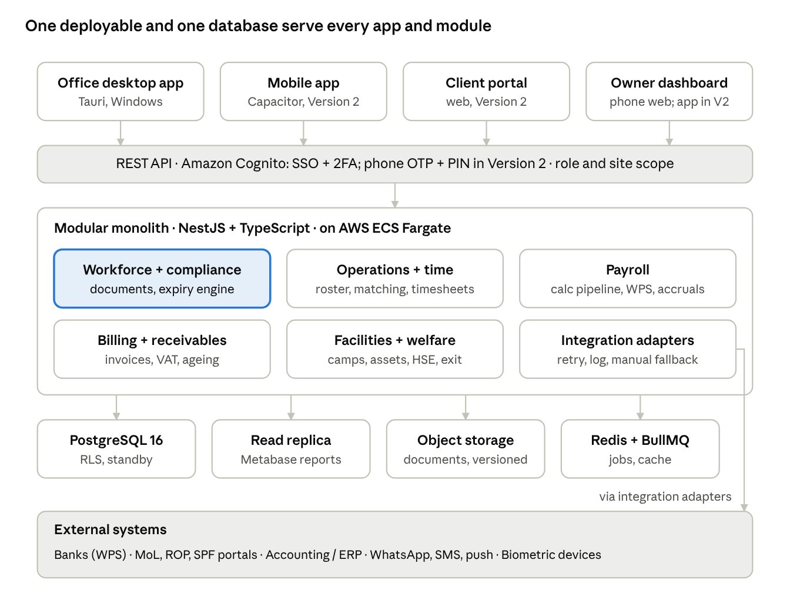

# Technical Spec

## 1. Architecture

Four front-ends talk to one secured API in front of a single modular backend and one PostgreSQL database, with every outside system reached only through integration adapters.

*Figure: system architecture · 4 apps, 6 modules, 4 stores*

it Modules talk to each other only through their published interfaces and domain events (an outbox table in the same database), so each can be tested alone and, if growth ever demands it, split out later without rewriting the others.

## 2. Technology stack

One language end to end (TypeScript), one database (PostgreSQL), and a modular monolith — the strongest, simplest stack for a system of this size that a small team can own for ten years.

**Why a modular monolith, not microservices.** 700 workers and ~25 office users is a small load; the hard parts are correctness and rules, not scale. One deployable with strict internal module boundaries gives transactional safety across payroll, billing and compliance, and can be split later if ever needed. Microservices here would add cost and failure modes for no benefit.

| Layer | Choice | Why |
|---|---|---|
| Backend | Node.js LTS + TypeScript, NestJS (modules map 1:1 to PRD modules) | Typed, testable, large hiring pool in the GCC and South Asia; same language as the shared interface |
| API | REST (OpenAPI 3.1, generated typed clients) + webhooks; GraphQL not needed | Simple, cacheable, easy for integrations and auditors to read |
| Database | PostgreSQL 16, money as NUMERIC(14,3) — never floating point | ACID transactions, row-level security, JSON where useful, full-text and trigram search good enough at this scale |
| Money maths | decimal.js in code, banker's-rounding rules defined per item and tested | Baisa-exact payroll and invoices |
| Background jobs | Redis + BullMQ (payroll runs, file generation, alerts, sync) | Retries, schedules, visibility |
| Files | Amazon S3 in the chosen AWS region, encrypted with KMS, versioned, virus-scanned on upload | Document vault at scale with immutable history |
| Shared interface | React + TypeScript (Vite), TanStack Query/Table, a design system built RTL-ready — one codebase for web, desktop and mobile | Every screen written once; English now, Arabic can be added later |
| Web | The shared interface served as a website (S3 + CloudFront) | The owner on any device, including the phone, and a fallback if an office PC fails; the client portal in Version 2 |
| Desktop app | Tauri 2, Windows first; Rust modules for silent printing and devices; signed auto-updater; MSI installer | Small, fast native app; silent bulk printing and device access a browser cannot do |
| Mobile apps | Version 2: Capacitor (Android first, iOS ready) wrapping the shared interface; official push, geolocation and camera plugins; SQLite for offline; supervisor, worker and owner modes | Mature mobile plugins; same screens and logic as web and desktop |
| Identity | Amazon Cognito: SSO + 2FA for office staff and the owner (Version 1) and for client contacts (Version 2); phone + OTP + PIN for supervisors and workers (Version 2) | Managed by AWS, nothing to patch or host; MFA built in |
| Reporting | Owner dashboard built in-app; report builder via embedded Metabase on a read replica | Ad-hoc reports without slowing operations |
| Messaging | WhatsApp Business API, local SMS gateway; Firebase push from Version 2 | Reach workers where they already are |
| OCR | Passport MRZ read from the uploaded scan on the server in Version 1 (on-device ML Kit reading in the Version 2 mobile app) + server-side OCR for other documents | Instant pre-fill from a scan |
| Infrastructure | AWS (client decision): ECS Fargate containers, RDS for PostgreSQL Multi-AZ, ElastiCache for Redis, KMS, Secrets Manager, WAF; Terraform for all infrastructure | Reproducible environments, no hand-built servers |
| Hosting region | An AWS Middle East region (UAE or Bahrain), confirmed by a PDPL cross-border transfer assessment and a data-processing agreement with AWS | Personal-data rules (see PRD section 6) |
| Observability | OpenTelemetry → Grafana stack; Sentry for app errors; uptime checks | Problems seen before users report them |

## 3. Core data model

Three records anchor everything — the Worker, the Client contract, and the locked Timesheet line — and every money figure in payroll and billing can be traced back to them.

### Modelling rules

- **Multi-entity from day one.** Every table carries `entity_id` (the legal company), so a UAE or second Oman entity is configuration, not a rewrite.
- **Effective dating.** Anything that changes over time (salary, rate card, assignment, rule version, status) is stored with `valid_from` / `valid_to`; history is never overwritten.
- **Lock, don't edit.** Once a timesheet, payroll run or invoice is approved it is immutable; corrections are new adjusting records that reference the original.
- **No hard deletes.** Records are archived with reason; personal data is anonymised on lawful erasure, keeping financial totals intact.
- **IDs.** UUIDv7 internally; human-readable codes for people (e.g. `W-000731`, `INV-2026-00412`).

### Entities

| Domain | Entity | Key fields | Relationships |
|---|---|---|---|
| Workforce | Worker | code, names (Latin + Arabic), nationality, DOB, trade, skill level, status, languages, phone | has many Documents, Assignments, Contracts of employment |
| Workforce | EmploymentContract | basic wage, allowances, hours, leave terms, ticket entitlement, valid_from/to | belongs to Worker; versioned on every pay change (drives WPS contract match) |
| Workforce | Document / DocumentType | type, number, issue, expiry, file versions, verified_by, mandatory_for (trades, sites) | belongs to Worker; feeds the compliance engine |
| Workforce | BankAccount | bank, IBAN/account (encrypted), verification status, valid_from | belongs to Worker; changes need 2-person approval |
| Recruitment | Agency, Candidate, CandidateCost | country, fees, stage, costs by type and currency | Candidate becomes Worker on arrival |
| Compliance | GovTransaction | type, reference, status, fees, waiting_on, due dates | linked to Worker and Document |
| Commercial | Client, Site, ClientContact | credit limit, terms, VAT status, geofence | Client has many Sites and Contracts |
| Commercial | ClientContract, RateCard, RateLine | trade × hour type × rate, minimum hours, inclusions, valid_from/to | priced against Timesheet lines |
| Operations | ManpowerRequest | trade, quantity, skills, site, start/end, shift | filled by Assignments |
| Operations | Assignment | worker, site, contract, role, start/end, shift pattern | the link that makes hours billable and payable |
| Time | AttendanceEvent | worker, time, source (office entry from a daily sheet and upload in Version 1; supervisor, self and biometric from Version 2), daily sheet and scan, GPS, photo, device | raw evidence, never edited |
| Time | Timesheet, TimesheetLine | period, date, hours by type, status (draft → submitted → client-approved → locked); each approval records its level (operations, client, and the supervisor from Version 2) and its evidence | built from AttendanceEvents; consumed by payroll AND billing |
| Payroll | PayPeriod, PayrollRun, Payslip, PayslipLine | run status, totals, line type, amount, derivation trace | Payslip lines reference TimesheetLines and RuleVersions |
| Payroll | Advance / Loan, Instalment, Deduction | principal, schedule, reason, approval | recovered through PayslipLines and final settlement |
| Payroll | Accrual | EOSB / savings, leave pay, ticket, monthly amount, balance | posted each run; settled at exit |
| Leave | LeaveType, LeaveBalance, LeaveRequest, TravelRecord | accrual rule, balance, dates, ticket, return due | blocks roster dates; feeds payroll |
| Billing | Invoice, InvoiceLine, CreditNote, Payment, Allocation | VAT, totals, due date, status | Invoice lines reference TimesheetLines and RateLines |
| Facilities | Camp, Room, Bed, BedAllocation, Vehicle, Route, AssetIssue | capacity, cost, dates, sizes | linked to Worker and Site |
| Welfare | Incident, Grievance, DisciplinaryAction, Training | severity, status, owner, deadlines, acknowledgements | linked to Worker and Site |
| Exit | Separation, FinalSettlement | reason, last day, settlement lines, signed statement | closes Worker; references Accruals, Loans, Assets |
| Platform | RuleTable, RuleVersion | rule key, parameters (JSON), effective dates, approved_by | every calculation records which version it used |
| Platform | User, Role, Permission, Scope; AuditEvent; Notification | role, site/client scope; before/after, actor, hash | applies across all modules |

The database uses PostgreSQL row-level security keyed on `entity_id` and on site/client scope, so a supervisor's or client's query physically cannot return another site's rows, even through a bug in application code.

## 4. Key engines

Four engines hold the business logic; each is a pure, deterministic function over data plus a rule version, so the same inputs always give the same answer and every answer can be explained line by line.

### 4.1 Compliance engine

- One function, `checkEligibility(worker, site, from, to)`, returns a list of blockers and warnings (expired or expiring document, missing site-specific certificate, leave overlap, rest-day breach, weekly-hours cap, client blacklist).
- Called by the roster board, the clock-in endpoint, the payroll run and the match engine — the same rules everywhere, so a worker blocked in one place is blocked in all.
- Nightly job recomputes every worker's compliance state and renewal calendar, emits alerts at 90/60/30/7 days, and opens renewal tasks in the HR/PRO queue.
- Overrides are records (who, why, until when), shown on the dashboard until they expire.

### 4.2 Rostering and matching

- Match score per candidate worker = hard filters (eligibility for the full period, trade, availability) then weighted ranking (skill level, client rating, distance from camp to site, language, continuity with this client, cost vs. rate-card margin). Weights configurable.
- Roster changes are validated server-side against the compliance engine before saving; conflicts return structured reasons the UI shows inline.
- Bench cost = daily fully loaded cost × idle days, computed nightly per worker.

### 4.3 Payroll calculation pipeline

1. **Freeze inputs:** locked timesheet lines, active contracts, leave, loans, deductions and the rule versions effective in the period (split by date if a rule changed mid-period).
2. **Earnings:** basic (pro-rated by calendar or working days per contract), allowances, overtime by type, holiday and rest-day pay, bonuses.
3. **Leave pay and absence:** paid leave, sick-leave tiers, unpaid days.
4. **Deductions:** loans and advances by schedule, then other deductions in a legally defined priority, stopping at the legal cap; anything over the cap rolls to next month and is flagged.
5. **Employer contributions and accruals:** gratuity or savings-system contribution, social protection contributions, leave and ticket accruals.
6. **Validation:** net ≥ 0; contract wage = WPS wage; variance vs. last month above threshold flagged; worker with blockers flagged.
7. **Outputs:** payslips with a derivation trace per line, WPS file per bank, accounting journal, cash list for unbanked workers.

Runs are idempotent: re-running a draft gives identical results; a released run is immutable, and corrections go into the next run as adjustment lines referencing the original.

### 4.4 Billing engine

- For each client contract and period: locked timesheet lines × matching rate line (trade, hour type, date) + fixed charges (accommodation, transport, mobilisation) − credits, applying minimum-hours rules.
- Invoices group per client's preference (site, PO, cost centre) and attach the timesheet summary as backup.
- Unmatched lines (no rate for that trade or hour type) block the invoice and land in the finance queue — nothing is silently unbilled.
- Daily reconciliation: approved hours vs. invoiced hours; the gap is the revenue-leakage number on the owner dashboard.
- Margin per line = billed amount − fully loaded cost of the same hours, rolled up per worker, site and client.

## 5. Integrations

Every integration sits behind an adapter with its own retry, logging and manual fallback, so an outside system being down never stops payroll or operations.

| System | Direction | Method | Phase | Fallback |
|---|---|---|---|---|
| Banks — WPS salary files | Out, then status back | Bank Muscat WPS file format first (template per bank, versioned, so another bank can be added); host-to-host or bank API where offered | P1 | Download file and upload in bank portal; rejection file imported back |
| Exchange houses / cash payroll | Out | Payment list export; signed receipt captured in app | P1 | Printed list with signatures, scanned |
| Ministry of Labour / ROP / SPF portals | Out and in | Most government services are portal-based; the system prepares data, documents and checklists, tracks reference numbers, and imports status exports. APIs adopted when offered | P1 tracking, P3 APIs | PRO officer completes the portal step; system holds the evidence |
| Accounting / ERP | Out | Not needed at launch: the built-in ledger (PRD 4.17) replaces Excel. If an ERP is adopted later, journals go out via API or CSV | P1 | CSV import |
| Biometric / face terminals | In | Device push SDK (e.g. ZKTeco and similar) or vendor cloud API into AttendanceEvents | P2 | Daily sheet or supervisor app attendance |
| Client timesheet systems | In | Client CSV/Excel upload with saved column mappings; API for large clients | P1 upload, P3 API | Manual entry with document attached |
| WhatsApp Business API | Out and in | Templated alerts (payslip ready, expiry, roster), approval links for the owner, two-way requests | P1 | SMS |
| SMS gateway (local provider) | Out | Critical alerts (and sign-in codes from Version 2) | P1 | Push notification |
| Push notifications | Out | Firebase Cloud Messaging / APNs through the mobile app; web push for the owner's installed web app where the phone supports it | Version 2 (web push in Version 1) | WhatsApp / email / SMS |
| Email | Out and in | Transactional email for clients and office; inbound email-to-ticket for client queries | P1 | — |
| Overseas agencies | In | Agency portal (limited role) to submit candidates and documents | P2 | Email upload |
| Maps / geocoding | Out | Site geofences, camp-to-site distance for matching and bus routes | P2 | Manual distance entry |

All inbound data lands in a staging area, is validated, and is shown as a reviewable batch before it changes live records; every outbound file is stored with a hash so the exact file sent to a bank or ministry can be produced later.

## 6. Security, privacy, audit and access control

The system holds 700 people's passports, bank accounts and wages, so the two threats designed against first are payroll fraud from inside and a data leak from outside.

### Access control

- Role-based permissions (the nine roles in PRD section 3) plus scope: entity, site, client. Enforced in the API and again by PostgreSQL row-level security.
- Field-level masking: passport, civil ID and bank numbers show the last 4 digits unless the role needs them; salary visible only to payroll, finance and owner.
- Office users and the owner: SSO, mandatory 2FA (authenticator app), session timeout 30 min idle, login alerts on new device.
- Supervisors and workers (Version 2 apps): phone + OTP on first login, then a 4–6 digit PIN or device biometrics; device binding; supervisors can reset with a recorded reason.
- Clients (Version 2) and agencies: separate login realm, scoped to their own data only.

### Anti-fraud controls (four-eyes)

| Action | Rule |
|---|---|
| Change a worker's bank account | Requested by one user, verified by a second (call-back or the worker confirms in person); held one payroll if changed within 5 days of a run |
| Change basic wage or allowances | Maker-checker; above a threshold needs owner approval |
| Release payroll | Payroll prepares, finance approves, owner approves above a set total |
| Create a new worker on payroll | Requires a verified passport and an active visa record — no "ghost workers" |
| Write-off, credit note, rate-card change | Maker-checker with reason |
| Export of bulk personal data | Logged, limited to admin and owner, watermarked |

### Data protection

- Encryption in transit (TLS 1.3) and at rest (database, backups, object storage); sensitive columns additionally encrypted with keys in a managed key service.
- AWS hosting in a PDPL-approved region under a data-processing agreement; a PDPL record of processing, privacy notices given to workers in their languages, consent captured at onboarding, and a data-subject request workflow with a 45-day clock.
- Breach runbook with detection, containment and notification steps and named owners; tested yearly.
- Retention schedule per data type (e.g. payroll and tax records kept for the legal period, recruitment data of rejected candidates purged after a set time).

### Audit

- Every write, approval, export and login creates an AuditEvent with actor, time, IP/device, and before/after values.
- Audit events are append-only and hash-chained so tampering is detectable; kept 10 years.
- Admins can view any record "as of" a past date, and see who changed what since.

### Application security

- OWASP ASVS level 2 as the baseline; dependency and container scanning in CI; secrets in a vault, never in code.
- Rate limiting and bot protection on login and OTP; file uploads type-checked, size-limited and virus-scanned.
- External penetration test before go-live and yearly.

## 7. Desktop, mobile, offline and localisation

Version 1 is the desktop and web apps, which need a connection. The Version 2 supervisor app must work a full shift with no signal; that constraint shapes the mobile design, and the worker app uses the same offline foundations.

### Platform design: one interface, three shells

Every screen is written once in the shared React interface and shipped three ways: as a website, as a Tauri desktop app for the office, and, from Version 2, as a Capacitor mobile app for supervisors, workers and the owner. All business rules and data stay on the server; the shells only add what each device does best. If the desktop shell ever has to change, the screens move with it in days, not months.

| Shell | Users | What it adds |
|---|---|---|
| Tauri desktop (Windows first) | Office staff (HR/PRO, operations, payroll, finance), the owner and the system admin | Silent bulk printing, scanners, card printers, native notifications, always-open window |
| Capacitor mobile (Android first) | Version 2: supervisors, workers and the owner | Offline store, GPS, camera, push notifications |
| Web | The owner on any device, including the phone (Version 1); clients through the portal (Version 2); fallback for the office | Nothing to install |

### Desktop app (Tauri)

- **Silent printing.** A Rust print module sends server-generated PDFs (payslips, ID cards, labels, statements) straight to the Windows print spooler, with a saved printer per job type on each PC. Large runs go through a print queue with progress, pause, retry and a per-document print log.
- **Devices.** Card printers, passport and barcode scanners (passport reading pre-fills the worker form), and document scanners that file straight into the worker's vault. Biometric terminals talk to the server, not the PC.
- **Updates.** Tauri's signed updater with staged rollout; the server refuses app versions below a set minimum, so no PC runs stale code.
- **Distribution.** MSI installer for IT, signed with a Windows code-signing certificate so Windows shows no security warnings; WebView2 runtime bundled.
- **Security.** Tauri's permission allow-list exposes only the print and device functions; login tokens kept in the Windows credential store; no business data saved on the PC beyond the session.
- **Must pass before P1 build:** silently print 700 payslips and 200 ID cards on the company's own printers. If it fails, the desktop shell switches to Electron, which prints silently out of the box, and nothing else changes.

### Offline sync (Version 2)

- Local SQLite store holds the supervisor's crews, rosters for the next 14 days, workers' photos and compliance state.
- Attendance events are written locally first with device time, GPS fix and a monotonic counter; queued and synced when online. The server records both device time and receipt time and flags large gaps.
- Sync is incremental (changes since last cursor), resumable and compressed; conflicts resolved by rule: attendance events are append-only (no conflicts), roster edits use server-wins with the losing edit shown to the user.
- Compliance state is cached, so an expired-document block works offline.

### Version 1 attendance capture (office)

Until the supervisor app arrives, attendance is captured on paper the system prints and entered in the office, with the same evidence and checks.

- **Daily sheets.** Each evening the system generates the next day's sheet for every site from the roster: worker code, name, trade and shift, with columns for in, out, absent or sick, overtime, the supervisor's signature and an optional client countersignature. A QR code holds the site, date and sheet number. Sheets print silently in the office or go to the supervisor as a PDF by WhatsApp.
- **Scan filing.** Photos arriving by WhatsApp and office scans are uploaded; the server reads the QR code and files each image against its site-day. Unreadable images go to a review queue.
- **Entry grid.** The grid opens pre-filled with every rostered worker present for the shift, so the timekeeper types only exceptions, with the scan shown beside it. Each saved row becomes an AttendanceEvent with source `office_entry` and the sheet's id.
- **Checks.** Rows that differ from the roster, workers not eligible on that date and hours above the legal maximum are flagged. A site-day with no filed scan is flagged the next morning. A different person reviews each site's week before it goes to the client.
- **Client approval.** A timesheet pack per site and period (summary and daily lines) is emailed from the system; the signed copy is uploaded and recorded as the client's approval, with the file as evidence.
- **Same records as Version 2.** When a site moves to the supervisor app, its events carry source `supervisor`; payroll, billing and reports do not change.

### Mobile device and network (Version 2)

- Target Android 9+ on 2 GB RAM, app under 30 MB, cold start under 3 seconds.
- Images compressed on device before upload; uploads resume after interruption.
- Anti-spoofing: mock-location detection, selfie liveness check for self clock-in, rooted-device warning.
- Shared-phone mode (for the worker app): quick switch with PIN, no data left after logout.

### Localisation

- All strings in ICU message format, translated by professional translators and reviewed by native-speaking workers before release.
- Office UI: English at launch, layout built RTL-ready so Arabic can be switched on later; names stored in Latin and Arabic script.
- Worker app (Version 2): workers' languages such as Bengali, Hindi, Urdu, Malayalam, Tamil and Nepali, added by configuration.
- Payslips and contracts in English at launch; workers' languages added with the worker app.
- Numbers shown with OMR and 3 decimals; dates in Gregorian with optional Hijri display; week start and weekend configurable per entity.
- Icons and colours carry meaning in the worker app (green = paid / valid, amber = action soon, red = blocked), always paired with text.

## 8. Performance, reliability, DevOps and testing

Payroll is tested like banking software: a signed-off library of real cases must pass on every code change, and no release reaches production without it.

### Environments and delivery

- Four environments: development, test, staging (production-like with anonymised data) and production; all built from Terraform.
- Git with protected main branch, mandatory code review by a second developer, CI on every pull request (lint, type-check, tests, security scans, build).
- Database changes as versioned migrations, backward-compatible, reviewed; never edited by hand in production.
- Releases weekly outside payroll week; freeze from 2 days before to 2 days after each payroll release. Feature flags for new rules and modules.

### Testing strategy

| Layer | What | Bar |
|---|---|---|
| Golden payroll suite | 300+ real worker scenarios (overtime mixes, mid-month joiners/leavers, leave, loans, rule changes mid-period, settlements), expected results signed by the payroll officer | 100% pass, baisa-exact |
| Golden billing suite | Rate-card scenarios per client contract type | 100% pass |
| Property-based tests | Invariants: net pay ≥ 0, deductions ≤ legal cap, invoice total = Σ lines + VAT, hours paid ≤ hours locked | No counter-example found |
| Unit and integration | Every module and adapter | ≥ 85% line coverage on engines |
| End-to-end | Critical journeys in web and desktop (mobile from Version 2) (hire → deploy → clock → pay → bill → exit) | Pass on each release |
| Offline | Version 2 supervisor app under airplane mode, poor network, device clock changes | No lost events |
| Load | 5,000 workers, month-end peak, 2,000 concurrent app users | Meets PRD section 7 targets |
| Parallel payroll | 2 live months, old method vs. system | All variances explained before cut-over |
| Usability | Task time budgets (PRD section 7) with real staff and workers | Targets met |

### Development approach: test-first, AI-assisted

Every feature starts as a failing test written from this document; AI agents write most of the code that makes it pass, and humans own the expected answers and the final review.

**Test-driven development (TDD)**

1. **Acceptance tests first.** Each PRD requirement becomes executable acceptance tests before any code (e.g. "a worker with an expired visa cannot be rostered").
2. **Red → green → refactor** for every engine and API endpoint: write the failing test, write the least code to pass it, then clean up with the tests still green.
3. **Expected values come from people, not code.** Payroll, end-of-service, overtime and billing cases are calculated and signed by the payroll officer or accountant; legal rules by the labour lawyer. The golden suites hold these signed cases.
4. **Tests prove the tests.** Mutation testing (Stryker) on the four engines confirms the tests catch deliberately broken code; target ≥ 80% mutation score.
5. **Contract tests** generated from the OpenAPI spec keep web, desktop and mobile in step with the server.
6. **End-to-end** with Playwright for the web app; WebDriver for the Tauri desktop app; Appium smoke tests for the Capacitor mobile app from Version 2.

**AI-assisted development**

- **Tools.** Claude Code as the main coding agent in each developer's environment and in CI (draft tests from requirements, implement to green, refactor, review pull requests, write migrations and docs).
- **Project rules file** (CLAUDE.md) in the repository: architecture, module boundaries, money rules (NUMERIC, decimal.js, rounding), naming, "tests first" and "never change a golden expected value" — so every agent session follows the same rules.
- **Guardrails.**
   - An agent never writes both a money rule and its expected value; expected values come from signed golden cases.
   - Every change goes through a pull request with green CI and a human reviewer; payroll, compliance, security and migration changes need a senior reviewer.
   - No real personal data in AI context: development uses generated, anonymised fixtures only.
   - Dependency, secret and security scans run on every pull request, whoever wrote the code.
- **Team effect.** AI assistance lets a smaller team (product lead, 3 engineers, part-time designer and QA) cover the P1 scope; Discovery confirms the estimate.

**Build order: web app first, then the desktop software**

1. **Web app** (all office modules in the browser) is built and tested first, so every feature is usable and testable from week one.
2. **Desktop software:** the same interface wrapped in Tauri, adding silent printing and devices, once the Discovery print test has passed.
3. **Version 2, after go-live:** the Capacitor mobile app (supervisor, worker and owner modes) and the client portal.

### Reliability and recovery

- Two AWS availability zones; RDS for PostgreSQL with synchronous standby and point-in-time recovery; object storage versioned and replicated.
- Backups encrypted, copied by AWS Backup to a separate, locked backup account, restore tested monthly; full disaster-recovery drill twice a year.
- Service levels watched on dashboards with alerts to on-call: API error rate, latency, job queue age, sync lag, WPS file status, nightly compliance job success.
- Runbooks for: failed payroll job, bank rejection, sync backlog, lost device, data breach, region outage.

### Ownership and handover

- The company owns the source code, infrastructure accounts, domain and data; contracts with any vendor say so.
- Deliverables include architecture records, API docs, runbooks, admin guide and recorded training, kept current with each release.
