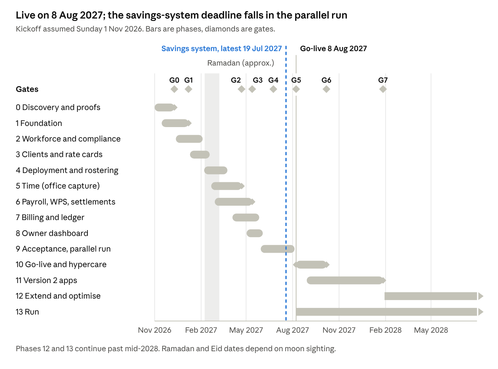

# Delivery Phases — start to end

2026-10-20 · sami

The system goes live on Sunday 8 August 2027, about nine months after a kickoff on Sunday 1 November 2026, through 14 phases with eight go/no-go gates. Go-live comes only after two parallel payrolls in which every variance is explained. This is Version 1: the software for the office, the owner and the system admin. Version 2 (the supervisor app, client portal and worker app) follows by 27 January 2028, then recruitment, camps and fleet, welfare and biometrics, and the system is then run, patched and kept current with the law for as long as the company uses it.

One date is fixed by law, not by us: the expatriate savings system (9% of basic wage to the Social Protection Fund) must start no later than 19 July 2027, and no earlier date had been set as of 16 October 2026. That falls before go-live, so the savings system moves from the extension phase into the launch payroll (Phase 6), with a fallback if the Fund announces an earlier date.

The kickoff date is an assumption. Every later date moves with it, but the order, durations and gates do not. Phases start on Sundays and gates fall on Thursdays, matching Oman's working week.

## Timeline

*Figure: plan dates · 14 phases, 8 gates, kickoff assumed 1 Nov 2026*

The build phases overlap so that payroll, which takes longest, starts in February. The savings system's latest legal start falls three weeks before go-live, inside the July parallel payroll, which is why it is built in Phase 6 rather than after go-live.

## How every phase runs

Every phase uses the same rhythm, so the owner always knows what was finished, what is next and what decision is waiting on them.

**Rhythm**

- Two-week sprints, starting on a Sunday. On the second Thursday, the team demonstrates working software on staging to the module's business owner.
- A 30-minute weekly status with the company: what's done, what's next, what's blocked, and the decisions needed this week.
- A 15-minute monthly demo for the owner, on a phone.
- Each phase ends at a gate or a module sign-off. A missed gate moves the date, never the quality bar.

**How a feature is built**

1. A requirement from the PRD becomes an acceptance test, written before any code.
2. An engineer, working with Claude Code, writes the least code that passes it, then cleans it up with the tests still green.
3. A second engineer reviews the change. Payroll, compliance, security and database changes need a senior reviewer.
4. It merges only when every check is green: unit and database tests, type checks, mutation testing on the engines (80% minimum), end-to-end tests at desktop and phone sizes, the Windows installer build and the API image build.
5. It reaches staging automatically, with anonymised data, and production only after approval.

**Done means done**

- [ ] Acceptance tests pass, and the module owner has seen it work on staging.
- [ ] Money and legal expected values come from signed golden cases, never from the AI or the code.
- [ ] Every screen meets its task time budget (PRD section 7), works at phone width and works with the keyboard.
- [ ] Every change is recorded in the audit trail, and the admin guide and runbooks are updated.
- [ ] No real personal data is in code, tests or prompts.

**Team**

| Side | People | Role |
|---|---|---|
| Delivery | Product lead (business analyst) | Requirements, acceptance tests, demos, gates |
| Delivery | 3 engineers, AI-assisted | Server, web and desktop (Rust printing) in Version 1; mobile app and client portal in Version 2 |
| Delivery | Part-time designer and QA | Screens, usability tests, test plans |
| Company | Owner | Approves gates, budget and scope |
| Company | One owner and one deputy per module (HR/PRO, operations, payroll, finance) | Requirements, golden cases, acceptance |
| Company | IT contact | AWS accounts, office PCs, printers, network |
| Advisers | Labour lawyer, tax adviser | Sign legal and VAT rule tables |

## Phase 0 — Discovery, data audit and platform proofs

1 Nov – 10 Dec 2026 · 6 weeks · ends at G0

Every requirement, legal rule and risky technical assumption is settled on paper or proven in code before the build starts.

- **Walk the real work.** Interview each role: the owner, HR/PRO, operations, payroll, finance, three supervisors, and ten workers in their own languages. Follow one month of real paperwork from timesheet to payslip to invoice.
- **Count and measure.** Record real volumes (workers by trade and site, active clients and sites, documents expiring per month, payroll lines, invoices). Measure today's baseline for every PRD goal: bench rate, unbilled hours, days to collect, payroll cycle days.
- **Sign the rules.** Draft the dated rule tables for hours, overtime, leave, deduction caps, gratuity, the savings system and Social Protection Fund contributions. The labour lawyer and tax adviser sign them.
- **Start the golden cases.** The payroll officer begins hand-calculating 300+ real pay scenarios. This runs on into Phase 6 and has the longest lead time of anything in the project.
- **Bank Muscat.** Get the WPS salary file specification and a test channel in week 1.
- **Data audit.** Check a 10% sample of worker files against the original documents. List every missing or expired document, and name who cleans each batch.
- **Platform proofs (must all pass):**
   - Print 700 payslips and 200 ID cards silently on the office's own printers.
   - Enter a printed 30-person daily sheet in the prototype grid in under 2 minutes, and file its photo by reading the sheet's QR code. (The offline phone proof moves to Version 2.)
   - Push a signed auto-update to a test PC.
- **Data protection (PDPL).** Complete the transfer assessment for the AWS UAE or Bahrain region, sign the data-processing agreement with AWS, appoint the data protection officer and write the record of processing.
- **Contract and accounts.** Agree that the company owns the code and IP. Open AWS accounts in the company's name and order the Windows code-signing certificate.
- **Prototype.** Test a clickable version of the six most-used screens with real staff.

Already done: a first working slice (worker files, the deployment check, renewals, audit trail, web app and desktop printing). It becomes the prototype base.

## Phase 1 — Foundation

15 Nov 2026 – 7 Jan 2027 · 8 weeks, overlapping Phase 0 · ends at G1

A production platform that is safe to hold real personal data. No real worker data enters any system before G1.

- **AWS, built from code (Terraform):** separate production, staging and backup accounts. The Bun API runs on ECS Fargate, with RDS PostgreSQL (Multi-AZ), S3, KMS, WAF and Secrets Manager, all in the PDPL-approved region.
- **Sign-in and roles:** Amazon Cognito with 2FA for office staff and the owner. All nine PRD roles and their site and client scopes are built and tested, but only the six Version 1 roles (owner, operations, HR/PRO, payroll, finance, admin) get accounts; supervisor, client and worker accounts open in Version 2.
- **Data protection inside the database:** row-level security by entity, site and client; masking of passport, ID and bank numbers; encryption at rest.
- **Recovery:** point-in-time recovery and backups to a locked account. The first full restore test happens in this phase.
- **Monitoring:** logs, metrics, alerts, error tracking (Sentry) and uptime checks.
- **Release pipeline:** the existing CI (tests, mutation gate, end-to-end, Windows installer, API image) deploys automatically to staging and to production on approval.
- **Design system:** the app shell and components finalised in English, built ready for Arabic.

Already done: repository, Bun toolchain, CI, hash-chained audit trail, migrations and test harness.

## Phase 2 — Workforce and compliance

13 Dec 2026 – 4 Feb 2027 · 8 weeks · ends with HR/PRO acceptance

Every worker's file and papers live in the system, correct, and policed by the compliance engine.

- **Worker master:** full profile, family and next of kin, bank account (changes need two people), trades and skill levels, status history.
- **Document vault:** scans with version history, passport reading by OCR, duplicate detection.
- **Government work:** transaction tracker, Omanisation ratio against requirement, absconding workflow, override approvals.
- **Renewal alerts** at 90, 60, 30 and 7 days, by WhatsApp, SMS and email to HR, the supervisor and the worker.
- **Import tool:** a validation report on every row. The cleaned worker files go into staging, and HR fixes every rejected row.

Already done: worker files, documents and HR verification, the deployment eligibility check, the renewals queue, overrides with named approvers, and the audit trail.

Ends with: the HR/PRO lead accepts the module on staging using the real, cleaned data.

## Phase 3 — Clients, contracts and rate cards

10 Jan – 18 Feb 2027 · 6 weeks · ends with operations and finance acceptance

Every client, site and contract price is in the system, so hours can later be billed without anyone retyping a rate.

- Clients, sites (with a map boundary, used for phone check-in from Version 2), contacts, credit limits, payment terms and documents.
- Contracts and rate cards by trade and hour type (normal, overtime, rest day, holiday, night), minimum hours, inclusions and price-escalation dates, all versioned by date.
- Manpower requests from clients, entered by the office now and through the client portal in Version 2.
- A margin preview on every quote: billing rate against the worker's full cost.
- Import current clients and contracts from Excel. The accountant checks every rate against the signed contracts.

Ends with: the operations manager and accountant accept the module on staging.

## Phase 4 — Deployment and rostering

7 Feb – 25 Mar 2027 · 7 weeks, longer because Ramadan falls inside it · ends with operations acceptance

Operations fill client requests from available, eligible workers in minutes, and can see the cost of every idle worker.

- Assignments with start and end dates, and transfers between sites and clients.
- A roster board (workers × days by site) that checks every change against the compliance engine before it saves.
- A matching engine that ranks available workers by trade, skill, valid documents, camp distance and cost.
- A bench view: who is idle, for how long, and what it costs per day.
- Daily bus pickup lists drawn from the roster. The full fleet module comes in Phase 11.

Ends with: the operations manager rosters one real week on staging alongside the current method, and both give the same answer.

## Phase 5 — Time and attendance (office capture)

21 Feb – 22 Apr 2027 · 9 weeks · ends at G2

Attendance moves from loose paper and WhatsApp to the system's own daily sheets, entered and checked in the office, and one locked timesheet becomes the single source for both payroll and billing.

- **Daily sheets and entry:** a sheet per site each day, pre-filled from the roster with a QR code, printed in the office or sent to the supervisor by WhatsApp; an entry grid pre-filled with the roster, so the timekeeper types only exceptions; the sheet's photo filed automatically by its QR code; Excel import of client gate sheets.
- **Timesheet rules:** shifts, breaks, overtime types, rest days, public holidays, night hours and Ramadan hours, all from the dated rule tables.
- **Approval chain:** a second person in operations checks each site, then the client signs the emailed timesheet pack (or it auto-approves per contract), then it locks. Disputes are raised on single lines, with the sheet scan, gate logs or a supervisor statement as evidence.
- **Checks:** lines that differ from the roster, workers not eligible that day and hours over the legal maximum are flagged; a site-day with no filed scan is flagged the next morning.
- **Pilot:** two sites for four weeks, from 21 March (after Eid al-Fitr), with the current method running in parallel.

Ends at G2.

## Phase 6 — Payroll, WPS and settlements

28 Feb – 13 May 2027 · 11 weeks · ends at G3

The system pays 700 people correctly to the baisa, sends the salary file to Bank Muscat, and can explain every line of every payslip.

- **Pay structures:** basic, allowances, overtime by type, bonuses.
- **Deductions:** applied in their legal priority order and stopped at the legal cap, with advances and loans repaid in instalments. Anything over the cap rolls to the next month and is flagged.
- **Payroll run:** freeze inputs → calculate → variance report against last month → payroll, finance and owner approvals → release. A released run can never be edited; corrections go into the next run.
- **WPS:** the Bank Muscat salary file, a check that contract wage equals paid wage, and import of the bank's rejection file. A signed cash list for workers paid through an exchange house.
- **Payslips:** PDF in English, sent by WhatsApp or SMS link and bulk-printed silently from the desktop app.
- **Social Protection Fund:** contributions, including the sick-leave insurance branch, which has been in force since 19 July 2026.
- **Expatriate savings system:** 9% of basic wage as a dated rule switched on at the Fund's start date (latest 19 July 2027). Gratuity accrual stops on that date and the amount already earned is carried as a liability until settled. This was planned for Phase 11; it moves here because the legal date comes before go-live.
- **Leave and travel:** balances, accrual, requests (entered by HR; by supervisors and workers from Version 2), tickets and return tracking.
- **Exit:** a guided checklist and a final settlement calculator. The worker signs the printed statement.
- **Golden suite:** all 300+ signed scenarios must pass, exact to the baisa.

Ends at G3.

## Phase 7 — Billing, receivables and ledger

4 Apr – 27 May 2027 · 8 weeks · ends with finance acceptance

Every approved hour is invoiced from the same locked timesheet, and the company's books move from Excel into the system.

- **Invoices:** locked timesheets × rate cards, with VAT tax invoices, timesheet backup attached, credit notes and disputed lines.
- **Collecting:** receivables ageing, automatic reminders, and credit-limit warnings to operations before more workers go to a client.
- **Leakage:** a daily unbilled-hours report and a check that every approved hour has been invoiced.
- **Ledger:** chart of accounts and cost centres per client and site. Journals are posted automatically from payroll and billing.
- **Supplier bills:** camp rent, fuel, bus maintenance, visas and agency fees.
- **Bank:** reconciliation against imported statements.
- **Month-end:** close with trial balance, profit and loss, balance sheet and VAT workings; a closed period is locked.
- **Golden billing suite:** signed cases for every contract type.

Ends with: the accountant closes one past month on staging, and it ties to the Excel books.

## Phase 8 — Owner dashboard and reports

2 May – 3 Jun 2027 · 5 weeks · ends with the owner's approval

The owner sees the health of the business on a phone and can tap any number to see the names behind it.

- Headcount, deployment and bench rate, revenue and margin by client, cash collected against due, payroll due and funded, and compliance risks.
- Approvals on the phone from a WhatsApp or email link that opens the web app (push notifications come with the Version 2 mobile app).
- About 40 standard reports, a report builder with saved views, and scheduled delivery by email or WhatsApp.

Ends with: the owner uses the dashboard for a week on staging data and approves it.

## Phase 9 — Acceptance, migration and parallel run

30 May – 5 Aug 2027 · 10 weeks · passes G4 on 24 June, ends at G5

The whole system is proven by the people who will use it, on their real data, before the old way is switched off.

1. **User acceptance (30 May – 24 Jun).** Each module owner runs scripted scenarios plus their own hardest cases, and the PRD task time budgets are measured with real staff. In parallel:
   - an external firm runs a penetration test;
   - a load test runs at 5,000 workers;
   - a full disaster-recovery restore is drilled.
2. **Training.** Office roles get at most one day each. Supervisors are shown the daily sheet on site (their app training comes with Version 2), plus one trained staff member per department who can teach others, plus recorded videos.
3. **Opening balances.** As at the cut-over date, load every opening balance and reconcile it line by line: leave balances, loans and advances, accrued gratuity, active assignments, unpaid invoices and the ledger. Each module owner signs their balances.
4. **Workers.** Record consent under PDPL, check phone numbers, and send a test WhatsApp message to every worker so payslips will reach them.
5. **Parallel run (27 Jun – 5 Aug).** The June and July payrolls and invoices run in both the old method and the system, and every difference is explained in writing. If the Fund keeps 19 July 2027, the July payroll is the first to include the savings system.

Passes G4 (24 June) and ends at G5.

## Phase 10 — Go-live and hypercare

8 Aug – 7 Oct 2027 · 9 weeks · ends at G6

The system becomes the only way the company works, with the delivery team on hand until two live payrolls have gone out cleanly.

- **Cut-over weekend:** final balances loaded and spreadsheets set to read-only, with a rehearsed rollback plan.
- **Live payrolls:** August wages (paid by about 3 September) and September wages (paid by about 3 October).
- **Hypercare:** an engineer on call, a 15-minute daily check-in for two weeks and then twice weekly. Payroll-blocking issues are fixed within 4 hours.
- **First results:** the PRD goals are measured against the Phase 0 baselines and reported to the owner.

Ends at G6.

## Phase 11 — Version 2: supervisor app, client portal and worker app

29 Aug 2027 – 27 Jan 2028 · 22 weeks, overlapping hypercare · ends at G7

The people outside the office get their own apps, built on the live system without disturbing payroll. Version 2 adds front doors to the same server, data and rules; nothing in Version 1 is rebuilt.

- **Supervisor app (Capacitor, Android first):** whole-crew attendance in one screen, working offline; shift swaps; leave, advance and other requests on behalf of workers; incident reports with photos; timesheet approval. Pilot at two sites for four weeks from 17 October 2027 with the daily sheet in parallel, then site by site until the sheet is retired.
- **Client portal:** approve timesheets, see deployed workers, download invoices and statements, place manpower requests, rate workers, raise complaints and see compliance certificates for deployed workers.
- **Worker app in workers' own languages:** payslips, documents and expiry dates, leave balance and requests, advances, announcements, and self check-in at sites that allow it; shared-phone mode.
- **Owner app and phone sign-in:** the owner mobile app with push notifications; phone sign-in (one-time code, then a PIN, bound to the device) for supervisors and workers.
- **Translations:** workers' languages (such as Bengali, Hindi, Urdu, Malayalam, Tamil and Nepali) translated professionally and checked by native-speaking workers before release.

Ends at G7.

## Phase 12 — Extend and optimise

From 30 Jan 2028 · run as a series of small projects

Each item below runs as its own small project, with the same steps: signed requirements, build, acceptance, release.

- **Extensions moved from Phase 11:** recruitment (agencies, candidate pipeline, cost per candidate); camps and fleet; welfare and safety; biometric terminals at the largest sites.
- **Arabic interface,** right to left.
- **Direct connections** to government and bank systems as they open: Ministry of Labour, ROP, Social Protection Fund, and Bank Muscat host-to-host salary files.
- **Work-injury insurance** for expatriates, planned by the Fund for 2028, once its rules are published.
- **Forecasting** of demand, bench and cash, and AI-assisted worker matching.
- **A second legal entity,** such as UAE, if the company expands.

## Phase 13 — Run

From 8 Aug 2027, for as long as the system is in use

The system stays correct, safe and current with the law year after year, without depending on any one person.

- **Releases:** every two weeks, never from two days before to two days after a payroll release.
- **Support:** a named contact, agreed response times, and a monthly service report to the owner.
- **Law changes:** a quarterly review of every rule table. Any announced change becomes a new dated rule, with its golden cases updated and signed before the change takes effect.
- **Security:** monthly patching, a quarterly access review, and a yearly external penetration test.
- **Recovery:** a monthly restore test and a full disaster drill twice a year.
- **Results:** the PRD goals measured at 12 months, and the roadmap reviewed twice a year.
- **Ownership:** the company owns the code, AWS accounts and data. Documentation, runbooks and the CLAUDE.md rules are kept current, so a new team or AI session can take over.

## Gates

Eight gates decide whether work moves on. Each has measurable criteria, and each is signed by a named person from the company, not by the delivery team.

| Gate | Date | Passes when | Signed by |
|---|---|---|---|
| G0 Discovery signed | 10 Dec 2026 | Requirements and rule tables signed by module owners, labour lawyer and tax adviser; data audit accepted with clean-up owners named; all three platform proofs passed; PDPL transfer assessment done; plan and budget approved | Owner |
| G1 Safe for real data | 7 Jan 2027 | Cognito sign-in and roles live; row-level security and masking tested; encrypted backups with one successful full restore; staging and production built from Terraform; foundation security review passed | Owner and IT contact |
| G2 Time capture proven | 22 Apr 2027 | At both pilot sites for 4 weeks: every rostered worker-day has a timesheet line backed by a filed sheet scan; a 30-person sheet entered in under 2 minutes; entered hours match the current method, with every difference explained | Operations manager |
| G3 Payroll proven | 13 May 2027 | Golden payroll suite 100% exact to the baisa; Bank Muscat accepts a test WPS file; settlement calculator, Fund contributions and savings-system rules signed | Payroll officer, accountant and labour lawyer |
| G4 Acceptance | 24 Jun 2027 | Every module accepted by its owner; task time budgets met; no high or critical penetration-test finding open; load and recovery tests passed; staff trained | Module owners and owner |
| G5 Go-live | 8 Aug 2027 | Two parallel payrolls with every difference explained; opening balances reconciled and signed; ≥ 90% of workers reachable for payslips; rollback rehearsed | Owner |
| G6 Hypercare exit | 7 Oct 2027 | Two live payrolls paid on time; no open payroll-blocking or high defects; spreadsheets retired; support handed over | Owner |
| G7 Version 2 live | 27 Jan 2028 | Supervisor app used for attendance at every site for 4 weeks (≥ 95% of attendance captured in the app, no events lost offline, a 30-person crew marked in under 60 seconds); client portal live for every client contact who approves timesheets; worker app released in the main workers' languages | Owner |

## Calendar constraints and risks to the dates

The plan already avoids Ramadan and the Eids for pilots, acceptance and go-live; the risks below are what could still move the dates, and each has a response agreed in advance.

### Calendar

| When | What | How the plan handles it |
|---|---|---|
| About 8 Feb – 9 Mar 2027 (moon sighting) | Ramadan: shorter working hours, less client time | Phase 4 is a week longer; no pilot, acceptance or release in this period |
| About 9–10 Mar 2027 | Eid al-Fitr | Pilot starts 21 March, after the holiday |
| About 16–17 May 2027 | Eid al-Adha | No releases that week; Phase 8 allows for it |
| About 5–7 Jun 2027 | Islamic New Year | Falls inside acceptance; one day planned out |
| Every month | Payroll release and the 3-day WPS deadline | No release from 2 days before to 2 days after a payroll release |
| No later than 19 Jul 2027 | Expatriate savings system starts | Built in Phase 6, tested in the July parallel payroll |
| Summer 2027 | Parallel run and go-live | Leave dates for module owners and deputies agreed at G0 |

### Risks

| Risk | Effect | Response |
|---|---|---|
| The Fund sets a savings-system start date earlier than 19 July 2027 | The company must pay 9% while still on Excel | The rule is ready by 13 May; until go-live, the system exports each worker's contribution for the Excel payroll |
| Worker records are worse than the Phase 0 sample shows | Phase 2 and the import slip | Clean-up starts in Phase 0 with named owners; G1 blocks only real data, not the build |
| Bank Muscat is slow to give the WPS specification or a test channel | G3 slips | Requested in week 1; the file format is a swappable template, built against the published spec first |
| Silent printing fails on the company's printers | The desktop app can't print in bulk without dialogs | Switch the desktop shell to Electron (days of work); the screens don't change |
| Daily sheets arrive late, incomplete or unreadable | Hours entered late or wrongly | Pre-filled sheets, so only exceptions are written; a photo by WhatsApp the same day; missing site-days flagged next morning; a second person checks every site-week. The supervisor app replaces the sheet in Version 2 |
| A module owner is unavailable at a gate | That gate waits | A named deputy per module, with authority to sign, agreed at G0 |
| New requests arrive mid-build | Launch slips | Non-legal changes go to Version 2 or Phase 12; legal changes go into the current phase |
| Golden cases take longer than planned | G3 slips | Started in Phase 0; progress tracked weekly |

## Sources

- [Teamed: Oman end-of-service and the 9% savings system](https://www.teamed.global/gulf-employment-law/oman-end-of-service-and-savings-system): start date not yet fixed; latest 19 July 2027 (reviewed 16 October 2026)
- [Bondoni: Key changes to end-of-service benefits for expatriates](https://bondoni-me.com/2026/06/03/client-alert-key-changes-to-end-of-service-benefits-for-expatriates/): scheduled for 19 July 2027; 9% of basic wage
- [Muscat Daily: Mandatory savings scheme among new social protection reforms](https://www.muscatdaily.com/2026/03/11/mandatory-savings-scheme-for-expats-among-new-social-protection-reforms/): work-injury insurance planned for 2028
- [KPMG: Updates to the Wage Protection System in Oman](https://kpmg.com/om/en/insights/2025/01/ministry-of-labour-updates-to-the-wage-protection-system-in-oman.html): wages transferred within 3 days of the period end
- [Khaleej Times: Likely dates of Ramadan and Eids in 2027](https://www.khaleejtimes.com/uae/ramadan-eid-al-fitr-eid-al-adha-2027-likely-dates): astronomical estimates; actual dates depend on moon sighting
