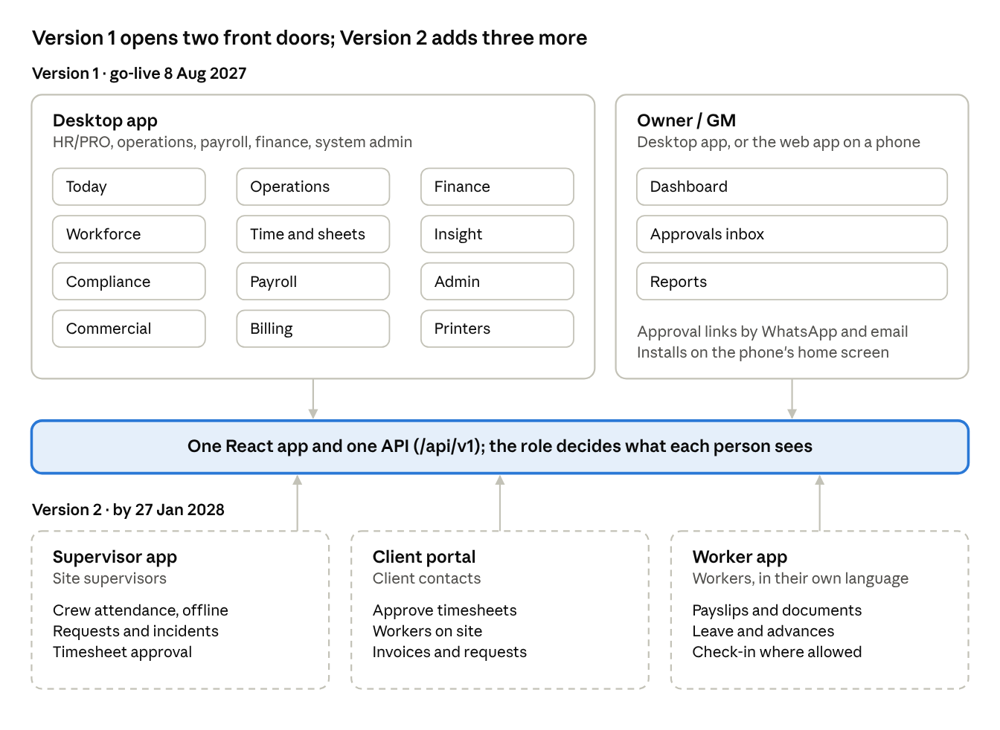
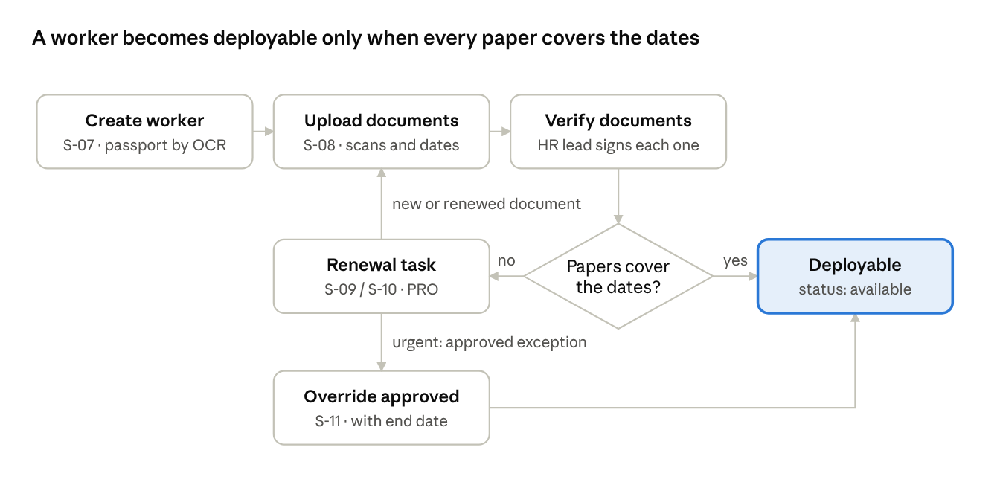
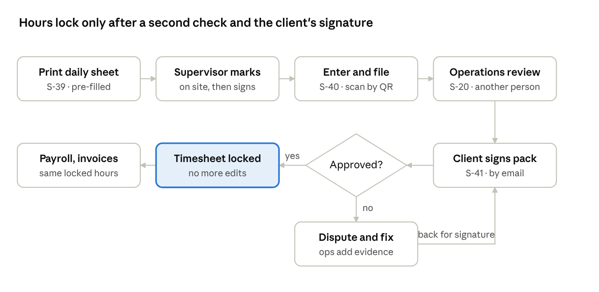
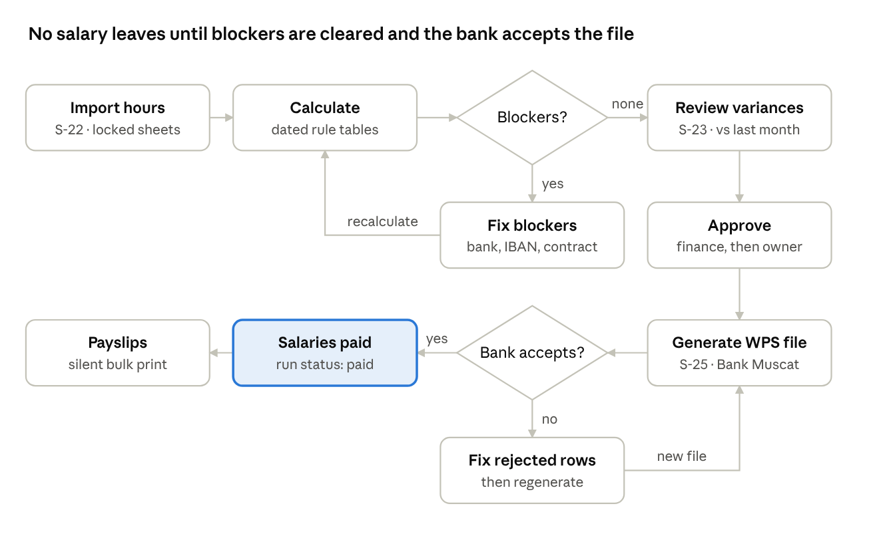
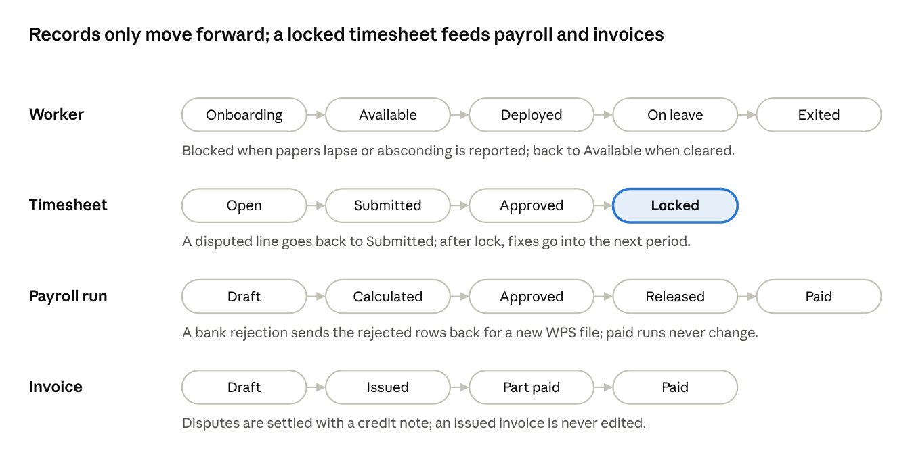

# App Flow

Version 1 opens the app to the office, the owner and the system admin: office staff and the admin work in the desktop app, and the owner uses the desktop app or the web app on a phone. Version 2 adds three more front doors: the supervisor app, the client portal and the worker app. Each person sees only the areas their role allows, and every core job is a short, linear flow with one obvious next step.

| Who | Front door | Opens on |
|---|---|---|
| HR/PRO, operations, payroll, finance | Desktop app (web as fallback) | Today: their own work queue |
| Site supervisors | Supervisor app (Android), Version 2 | Today's crew at their site |
| Owner / GM | Desktop app, or the web app on a phone (mobile app in Version 2) | Dashboard and approvals |
| Client contacts (Version 2) | Web portal | Timesheets waiting for approval |
| System admin | Desktop app | Users, roles and rule tables |
| Workers (Version 2) | Worker app | Their payslip and next shift |

Until the worker app arrives, workers receive payslips, roster changes and reminders by WhatsApp or SMS, and HR records their requests. In Version 1 supervisors have no account: they mark the printed daily sheet and receive WhatsApp messages.

## Navigation map

*Figure: navigation map · 2 front doors in Version 1, 3 more in Version 2*

Every front door is the same React app; the sign-in role decides which sections appear and which rows inside them a person can see. Office roles see only the desktop sections their role grants (payroll staff do not see Commercial, for example). From Version 2, supervisors see only their own sites, client contacts only their own company and workers only their own records.

## Screen inventory

Forty-one screens in Version 1 (S-01 to S-41) and four more in Version 2 (M-01, M-02, C-01, W-01). IDs (S-xx) are used in the Implementation Plan and in tests.

| ID | Screen | Area | Main users | Front door | Purpose | Phase |
|---|---|---|---|---|---|---|
| S-01 | Sign in | Shell | Everyone | All | Sign in with two-factor (phone code for supervisors and workers in Version 2) | 1 |
| S-02 | Today | Shell | Office roles | Desktop | The user's work queue: tasks, approvals, alerts | 2 |
| S-03 | Global search | Shell | Office roles | Desktop | Find any worker, client, invoice or document (Ctrl+K) | 2 |
| S-04 | Notifications | Shell | Everyone | All | Alerts and messages, with read state | 2 |
| S-05 | Workers list | Workforce | HR/PRO, operations | Desktop | Search and filter by paper status, trade, site | 2 |
| S-06 | Worker file | Workforce | HR/PRO, operations | Desktop | Profile, documents, assignments, pay, leave, history | 2 |
| S-07 | New worker | Workforce | HR/PRO | Desktop | Create a worker, with passport reading by OCR | 2 |
| S-08 | Document upload | Workforce | HR/PRO | Desktop | Drag-and-drop scans, check details, verify | 2 |
| S-09 | Renewals | Compliance | HR/PRO | Desktop | Expired and expiring documents, most urgent first | 2 |
| S-10 | Government transactions | Compliance | HR/PRO | Desktop | Applications, references, who is waiting on whom | 2 |
| S-11 | Overrides | Compliance | Operations manager | Desktop | Approve or end exceptions, with reason and end date | 2 |
| S-12 | Clients list | Commercial | Operations, finance | Desktop | Clients, credit status, open requests | 3 |
| S-13 | Client file | Commercial | Operations, finance | Desktop | Sites, contacts, contracts, invoices | 3 |
| S-14 | Contract and rate card | Commercial | Operations, finance | Desktop | Rates by trade and hour type, with versions | 3 |
| S-15 | Manpower requests | Operations | Operations | Desktop | Open requests and how many are filled | 3 |
| S-16 | Match workers | Operations | Operations | Desktop | Ranked eligible workers for a request | 4 |
| S-17 | Roster board | Operations | Operations | Desktop | Workers by days by site, drag to assign | 4 |
| S-18 | Bench | Operations | Operations, owner | Desktop | Idle workers, days idle, daily cost | 4 |
| S-19 | Timesheets | Time | Operations, payroll | Desktop | Status by site and period, chase missing approvals | 5 |
| S-20 | Timesheet detail | Time | Operations, payroll | Desktop | Lines with evidence, disputes, corrections | 5 |
| S-21 | Leave | Time | HR, payroll | Desktop | Requests, balances, travel and return dates | 6 |
| S-22 | Payroll runs | Payroll | Payroll officer | Desktop | Periods and run status | 6 |
| S-23 | Payroll review | Payroll | Payroll, finance | Desktop | Variances, blockers, approvals | 6 |
| S-24 | Payslip | Payroll | Payroll, HR | Desktop | Every line with how it was derived | 6 |
| S-25 | WPS files | Payroll | Payroll, finance | Desktop | Generate, download or send, bank responses | 6 |
| S-26 | Advances and loans | Payroll | Payroll | Desktop | Balances and repayment schedules | 6 |
| S-27 | Exit and settlement | Payroll | HR, payroll | Desktop | Checklist and final settlement statement | 6 |
| S-28 | Invoices | Billing | Finance | Desktop | Draft, issued, disputed, paid | 7 |
| S-29 | Receivables | Billing | Finance | Desktop | Ageing, reminders, credit warnings | 7 |
| S-30 | Ledger and close | Finance | Accountant | Desktop | Journals, bank reconciliation, month-end close | 7 |
| S-31 | Supplier bills | Finance | Accountant | Desktop | Camp rent, fuel, visas, agency fees | 7 |
| S-32 | Owner dashboard | Insight | Owner | Phone, web | Health of the business; tap any number for names | 8 |
| S-33 | Approvals inbox | Insight | Owner, managers | Phone, desktop | Everything waiting for this person's approval | 8 |
| S-34 | Reports | Insight | Managers | Desktop | Standard reports, saved views, scheduled delivery | 8 |
| S-35 | Printers | Desktop | Office roles | Desktop only | Printer per job type, test page | 2 |
| S-36 | Admin: users and roles | Admin | System admin | Desktop | Accounts, roles, site and client scope | 1 |
| S-37 | Admin: rule tables | Admin | System admin | Desktop | Dated legal and pay rules, with sign-off | 6 |
| S-38 | Admin: audit and health | Admin | System admin | Desktop | Audit search, chain check, integration health | 1 |
| S-39 | Daily sheets | Time | Operations | Desktop | Print or send tomorrow's pre-filled sheet for every site | 5 |
| S-40 | Attendance entry | Time | Operations timekeeper | Desktop | Enter a sheet's exceptions beside its scan; missing sheets listed | 5 |
| S-41 | Client timesheet packs | Time | Operations | Desktop | Email packs to clients, record signed approvals, chase late ones | 5 |
| M-01 | Crew today | Supervisor app | Supervisors | Phone | Whole-crew attendance in one screen, offline | V2 (11) |
| M-02 | Requests and incidents | Supervisor app | Supervisors | Phone | Leave, advances, incidents with photos | V2 (11) |
| C-01 | Client portal | Portal | Client contacts | Web | Approve timesheets, see workers, download invoices, place requests | V2 (11) |
| W-01 | Worker app | Worker app | Workers | Phone | Payslips, documents, leave and requests in their own language | V2 (11) |

## Flow: new worker to deployable

A new arrival becomes deployable the moment every required paper is verified and valid for the dates, and not a moment before.

*Figure: new worker to deployable · 6 steps, 1 decision, 2 loops*

1. **Create.** HR/PRO create the worker (S-07). The passport page is read by OCR, and HR check the details. The worker gets a code such as W-000123.
2. **Upload.** HR/PRO add scans of the passport, visa, labour card, medical and civil ID, with issue and expiry dates (S-08).
3. **Verify.** The HR lead checks each scan against its dates and verifies it. Every verification records who did it and when.
4. **Check.** The compliance engine checks every paper against the dates the worker would work, plus any extra papers a site requires.
5. **Deployable.** With nothing missing or expiring, the worker shows as available and appears in matching (S-16).

When it goes wrong: a missing or expiring paper creates a renewal task for the PRO (S-09, S-10); once the new paper is uploaded and verified, the check runs again. For an urgent case, the operations manager can approve an override (S-11) with a reason and an end date; it is recorded and expires on its own.

## Flow: client request to workers on site

Operations fill a request from eligible workers in minutes; the system refuses anyone whose papers don't cover the whole period.

1. **Request arrives.** Operations enter it from a call or email (S-15); from Version 2 the client can also place it in the portal: trade, quantity, site, dates, shift.
2. **Match.** Operations open the request and see eligible workers ranked by skill, camp distance and cost (S-16). Ineligible workers are shown greyed out, with the reason.
3. **Assign.** Operations pick workers. The roster board (S-17) checks every assignment with the compliance engine before saving.
4. **Transport.** The next day's bus pickup lists update from the roster.
5. **Notify.** Each worker gets a WhatsApp message with site, start date and pickup point. The worker appears on the site's next daily sheet, and the supervisor gets a WhatsApp message (from Version 2, the supervisor's crew list and the client's portal update instead).
6. **Close.** The request shows as filled. Any shortfall stays open, and the client sees the filled count.

When it goes wrong: if no eligible worker exists, operations see why (trade, papers, availability), and can raise a recruitment need (Phase 11) or offer the client a later start date.

## Flow: daily attendance to locked timesheet

In Version 1, attendance is written once on the system's own pre-filled sheet, entered and checked in the office, and the same hours flow into payroll and invoices after the client signs them off. Version 2 moves the marking onto the supervisor's phone; everything after it stays the same.

*Figure: attendance to locked timesheet · 7 steps, 1 decision, dispute loop*

1. **Print.** Each evening the system produces tomorrow's sheet for every site from the roster (S-39), with each worker's code, name and shift, and a QR code for the site and date. Sheets print silently in the office or go to the supervisor by WhatsApp.
2. **Mark.** On site, the supervisor marks only exceptions (absent, late, sick, overtime), signs, and sends a photo to the office the same day. Originals come in weekly.
3. **Enter and file.** The timekeeper opens the site-day (S-40): the grid is already filled with the roster, so only the exceptions are typed, with the photo beside it. The photo is filed to the site-day by its QR code.
4. **Check.** The server flags lines that differ from the roster, workers not eligible that day and hours over the legal maximum. A site-day with no filed photo is flagged the next morning.
5. **Review.** Someone in operations other than the timekeeper reviews the site's week and submits it (S-20).
6. **Client sign-off.** The system emails the client a timesheet pack (S-41). Operations upload the signed copy and record the approval; unsigned packs auto-approve after the contract's agreed days.
7. **Lock.** Approved timesheets lock. Payroll and invoices both read the same locked hours.

When it goes wrong: the client disputes specific lines with a reason. Operations correct them or attach evidence (the signed sheet, gate logs or a supervisor statement), and the pack goes back to the client. After lock, a correction goes into the next period as an adjustment, never as an edit. In Version 2 the supervisor marks the crew in the app (M-01) instead of steps 1–3, and the client approves in the portal (C-01) instead of signing a pack.

## Flow: monthly payroll to Bank Muscat WPS

Payroll runs from locked hours and dated rule tables; no salary file leaves until every blocker is cleared and the run is approved.

*Figure: payroll to Bank Muscat WPS · 9 steps, 2 decisions, 2 loops*

1. **Import.** The payroll officer opens the period (S-22). Locked timesheets, approved leave, loans and advances come in automatically.
2. **Calculate.** The pay engine works out basic, overtime, allowances, deductions, sick-leave insurance and the savings-system contribution, using the rule versions in force for the period.
3. **Blockers.** Anyone who cannot be paid correctly (no bank account, invalid IBAN, no active contract) is listed. Payroll fixes them and recalculates.
4. **Review.** Payroll compares every worker with last month (S-23) and explains large differences.
5. **Approve.** Finance approves, then the owner. Each approval records who, when and the totals they saw.
6. **Generate.** The system builds the WPS salary file for Bank Muscat (S-25) and records its checksum.
7. **Paid.** When the bank confirms, the run is marked paid and payslips print in bulk with no dialogs from the desktop app.

When it goes wrong: if the bank rejects rows, payroll fixes only those rows and generates a new file for them. A paid run is never edited; corrections go into the next run.

## Flow: invoice to cash collected

Invoices come from the same locked timesheets as payroll, so every approved hour is billed and finance spends its time collecting, not typing.

1. **Generate.** When the period closes, finance generates all invoices in one action (S-28): locked hours times each contract's rate card, plus fixed charges and VAT, with the timesheet summary attached.
2. **Fix exceptions.** Any line with no matching rate blocks its invoice and appears in finance's queue. Nothing is skipped silently.
3. **Approve and issue.** Finance reviews and issues the invoices. Issued invoices are locked, and each client receives a PDF by email (and in the client portal from Version 2).
4. **Collect.** Receivables ageing (S-29) sends automatic reminders. Operations see a warning before sending more workers to a client who is over their credit limit.
5. **Record payment.** Bank statement lines are matched to invoices. Partial payments are allocated, and the ledger is posted automatically.
6. **Disputes.** A client disputes specific lines. Finance issues a credit note or confirms the line with evidence; the original invoice is never edited.

The owner dashboard shows unbilled hours and overdue receivables every day.

## Flow: exit and final settlement

Every exit, whatever the reason, follows one guided checklist, so nothing owed in either direction is missed.

1. **Start the exit** from the worker file (S-27): resignation, termination, contract end, transfer of sponsorship, absconding or death. Each reason loads its own checklist.
2. **Set the last working day.** The system ends assignments, removes the worker from future rosters, and tells their supervisor.
3. **Collect what's owed back:** PPE, tools and the camp bed, recorded item by item. The value of anything not returned goes into the settlement only if the contract allows it.
4. **Calculate the settlement:** unpaid salary, leave encashment, gratuity earned up to the savings-system switch date, return ticket, minus outstanding loans and advances. Each line shows how it was calculated.
5. **Approve.** Payroll prepares, finance approves, and the owner approves above a set amount.
6. **Pay and sign.** Payment goes through WPS. The worker signs the printed statement (in their own language from Version 2), and the signed scan is stored and locked.
7. **Close.** HR/PRO track visa and labour card cancellation to completion. The worker's status becomes Exited, with a rehire flag.

For absconding, pay and access are frozen at the report date, and the legal reporting steps are tracked. If the worker returns, every step can be reversed, with a record of each one.

## Record states

Every main record has a status that moves forward only. A badge shows the status everywhere the record appears, and every change of status is written to the audit trail.

*Figure: record states · worker, timesheet, payroll run, invoice*

The database enforces these steps: a status can only change along an allowed arrow, and records past their locking state (locked timesheets, paid runs, issued invoices) reject edits.

## Behaviour everywhere

These rules apply on every screen, so people learn the app once.

| Situation | Behaviour |
|---|---|
| No permission | Areas the role can't use don't appear. An action the user can see but can't take right now is disabled, with a tooltip saying why (e.g. "Needs a second approver"). |
| Field errors | Shown under the field as the user leaves it, in plain words, and repeated in a summary at the top on submit. Input is never lost. |
| Server or network errors | A toast says what failed and offers Retry. Office screens keep unsaved input in the form if the connection drops, under a banner: "You're offline. Changes will save when you reconnect" only where saving later is safe; otherwise "Reconnect to save". |
| Loading | Skeleton rows in tables, never a blank page. Long jobs (payroll, invoices, print batches) show step-by-step progress and can run in the background. |
| Empty states | Say what belongs here and offer the one action that fills it ("No documents yet. Add the passport first."). |
| Approvals | Everything waiting for a person appears in their Approvals inbox (S-33) and on Today, with a WhatsApp or email link that opens it on a phone (push notifications from the Version 2 mobile app). Approving from a phone takes two taps. |
| Dangerous actions | Releasing payroll, issuing invoices and closing a period show what will happen and need the user to type the period name to confirm. Nothing irreversible happens in one click. |
| Undo | Edits that aren't locked can be undone for 10 seconds from the toast. Locked records offer a correction instead. |
| Notifications | In-app first. Approvals and blockers also go by email and WhatsApp links (push notifications from Version 2). Workers receive WhatsApp, with SMS as fallback. A daily email digest is optional. |
| Keyboard | Ctrl+K search, / to focus a table filter, J and K to move between rows, Enter to open, Esc to close. Every action is reachable without a mouse. |
| Offline (Version 2 supervisor app) | Everything works. A badge shows how many items are waiting to sync, and the screen says when they've synced. |
| Session | After 30 minutes idle, office sessions lock; signing back in returns to the same screen with input kept. |
