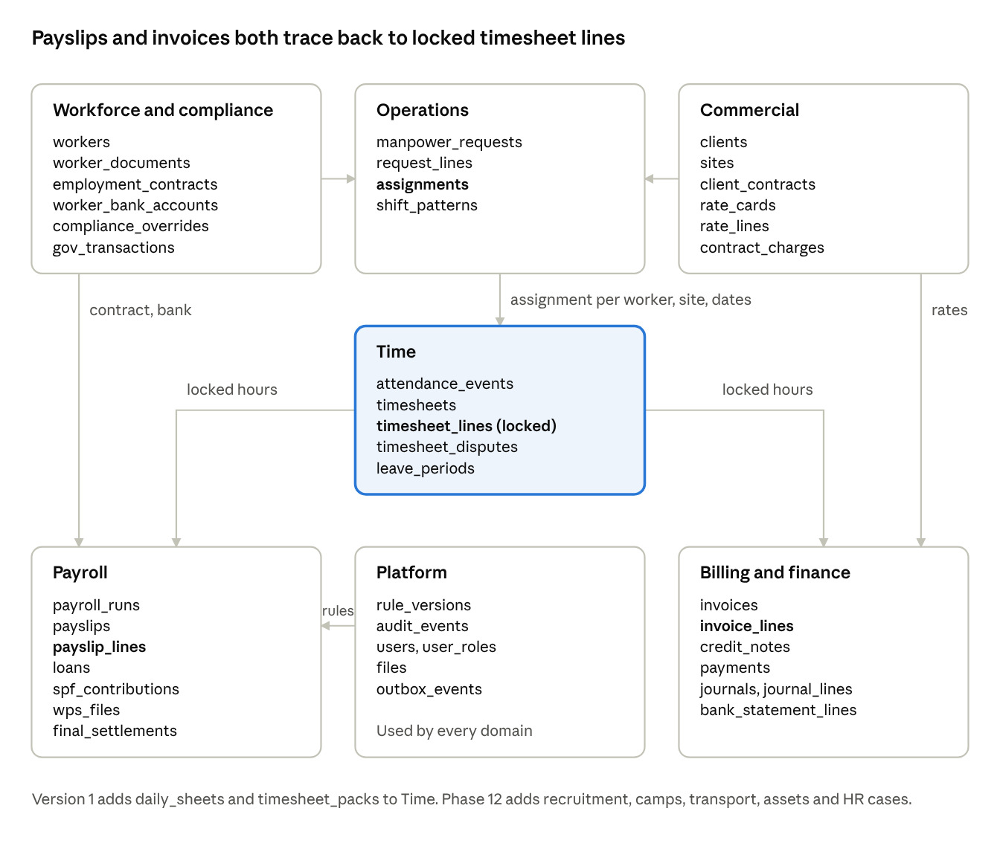

# Backend Schema

The database holds about 80 tables in eight domains, all in one PostgreSQL 16 database. Three tables anchor everything: the worker, the client contract and the locked timesheet line. Every amount on a payslip or invoice traces back to them. Tables marked **built** already exist in the first slice (migrations 0000–0002).

### Conventions every table follows

| Topic | Rule |
|---|---|
| Names | `snake_case`, plural table names, singular column names. Foreign keys are `<table_singular>_id`. |
| Primary keys | `id uuid` (time-ordered UUIDv7 for new tables). Human-readable codes sit in a separate unique column, such as `W-000731` or `INV-2026-00412`. |
| Entity | Every business table has `entity_id text NOT NULL`, part of every unique key and every row-level security policy. |
| Audit columns | `created_at`, `updated_at` (timestamptz), `created_by`, `updated_by` (user id). Every change also writes to `audit_events`. |
| Money | `NUMERIC(14,3)`, OMR to the baisa. Other currencies use NUMERIC(16,4) with a `currency` column and a stored exchange rate. |
| Dates | Calendar dates as `DATE` (Oman time); moments as `timestamptz` (UTC). |
| Effective dating | Things that change over time have `valid_from DATE NOT NULL` and `valid_to DATE NULL`. An exclusion constraint stops two versions overlapping. |
| Status | `text` with a CHECK list of allowed values. Moves between statuses go through service methods, never direct updates. |
| Deleting | Never. Rows get `archived_at` and `archive_reason`. Foreign keys use `ON DELETE RESTRICT`. |
| Locking | Records that become final carry `locked_at` and `locked_by`; a trigger rejects any change after locking. |
| Personal data | Columns holding ID and bank numbers are encrypted per column and listed in the anonymiser configuration. |

## Entity map



*Figure: entity map · core tables in 7 domains*

A worker is placed on a site through an **assignment**, which links the worker to a client contract's request. Attendance against that assignment becomes **timesheet lines**; once locked, the same lines are priced twice: by the pay engine into **payslip lines** (using the worker's contract and the signed rule versions) and by the billing engine into **invoice lines** (using the contract's rate lines). Platform tables, above all `audit_events` and `rule_versions`, serve every domain.

## Platform

| Table | Key columns | Rules |
|---|---|---|
| `entities` | `id` (e.g. OM-01), `legal_name`, `cr_number`, `country`, `currency`, `week_start`, `weekend_days` | One row per legal company; seeded with the Oman entity |
| `users` | `id`, `cognito_sub`, `display_name`, `email`, `phone`, `status`, `last_sign_in_at` | No passwords stored; identity comes from Cognito |
| `roles` | `key` (owner, ops_manager, hr_pro, payroll, finance, supervisor, client, admin, worker), `name` | The nine PRD roles. Version 1 issues accounts for six; supervisor, client and worker accounts open in Version 2 |
| `permissions` | `key` (e.g. `payroll.release`, `pii.view`), `description` | Declared in code and synced by migration |
| `role_permissions` | `role_key`, `permission_key` | Default deny |
| `user_roles` | `user_id`, `role_key`, `entity_id`, `site_id NULL`, `client_id NULL`, `valid_from`, `valid_to` | Scope limits a supervisor to sites and a client contact to one client |
| `rule_tables` | `key` (e.g. `overtime.day`, `savings.rate`), `description`, `owner_role` | One row per legal or pay rule |
| `rule_versions` | `rule_key`, `entity_id`, `params jsonb`, `valid_from`, `valid_to`, `signed_by`, `signed_at`, `source_ref` | No overlapping versions; a version can't be used until it is signed; every calculation stores the version it used |
| `audit_events` **built** | `id bigserial`, `actor`, `action`, `subject_type`, `subject_id`, `before`, `after`, `at`, `prev_hash`, `hash` | Append-only by trigger; SHA-256 chain; never truncated |
| `files` | `id`, `s3_key`, `sha256`, `mime`, `bytes`, `scan_status` (pending, clean, infected), `uploaded_by`, `object_lock_until NULL` | A file can't be opened until scanned clean |
| `notifications` | `id`, `user_id`, `kind`, `subject_type`, `subject_id`, `title`, `body`, `read_at` | In-app notifications |
| `message_deliveries` | `id`, `channel` (whatsapp, sms, email, push), `recipient`, `template`, `status`, `provider_ref`, `attempts`, `last_error` | One row per outgoing message, with delivery and read status |
| `outbox_events` | `id`, `topic`, `payload jsonb`, `created_at`, `published_at NULL` | Written in the same transaction as the change; published by a job |
| `job_runs` | `id`, `queue`, `name`, `idempotency_key`, `status`, `started_at`, `finished_at`, `error` | Unique on `idempotency_key` |
| `consents` | `id`, `worker_id`, `notice_version`, `language`, `channel`, `given_at`, `withdrawn_at` | PDPL consent record |
| `data_requests` | `id`, `subject_type`, `subject_id`, `kind` (access, correction, erasure), `received_at`, `due_at`, `status` | `due_at` is 45 days after receipt |
| `settings` | `entity_id`, `key`, `value jsonb` | Non-legal configuration only |

## Workforce and compliance

| Table | Key columns | Rules |
|---|---|---|
| `workers` **built** | `id`, `code` (W-000001), `full_name`, `full_name_ar`, `nationality`, `trade`, `status`, `phone`, `date_of_birth`, `joined_on` | Status is one of in_recruitment, available, deployed, on_leave, absconding_reported, exited; changes go through the status service |
| `worker_status_history` | `worker_id`, `status`, `valid_from`, `valid_to`, `reason`, `changed_by` | No overlaps; the current row has `valid_to` empty |
| `worker_documents` **built** | `id`, `worker_id`, `type`, `number` (encrypted), `issue_date`, `expiry_date`, `verified`, `verified_by`, `verified_at`, `file_id` | Expiry on or after issue; the latest expiry per type is the one that counts |
| `document_types` | `key`, `label`, `mandatory`, `required_for_trades text[]`, `alert_tiers int[]` | Reference data, replacing the code list over time |
| `employment_contracts` | `id`, `worker_id`, `basic_wage`, `allowances jsonb`, `hours_per_week`, `leave_days`, `ticket_entitlement`, `valid_from`, `valid_to`, `file_id` | A new version for every pay change; WPS checks paid wage against this |
| `worker_bank_accounts` | `id`, `worker_id`, `bank`, `iban` (encrypted), `status` (pending, verified), `requested_by`, `approved_by`, `valid_from` | Requester and approver must differ |
| `worker_family` | `worker_id`, `name`, `relation`, `phone`, `is_emergency_contact` |  |
| `worker_skills` | `worker_id`, `trade`, `level` (1–5), `certified_until` | Feeds matching |
| `gov_transactions` | `id`, `worker_id`, `type` (visa_new, visa_renewal, labour_card, transfer, cancellation, clearance), `reference`, `status`, `waiting_on` (company, ministry, worker), `fees`, `submitted_on`, `completed_on` | Linked to the document it renews |
| `compliance_overrides` **built** | `id`, `worker_id`, `code`, `document_type`, `valid_until`, `approved_by`, `reason` | Never for an inactive worker; an approver and reason are always required |
| `absconding_reports` | `id`, `worker_id`, `reported_on`, `reported_to`, `reference`, `status`, `returned_on` | Freezes pay and access from `reported_on` |
| `omanisation_requirements` | `entity_id`, `activity`, `required_ratio`, `valid_from`, `valid_to` | The live ratio is calculated, not stored |

## Commercial

| Table | Key columns | Rules |
|---|---|---|
| `clients` | `id`, `code`, `legal_name`, `cr_number`, `vat_number`, `credit_limit`, `payment_terms_days`, `status` |  |
| `client_contacts` | `id`, `client_id`, `name`, `email`, `phone`, `can_approve_timesheets`, `user_id NULL` | A contact with a `user_id` can sign in to the portal (Version 2); in Version 1 contacts receive timesheet packs and invoices by email |
| `sites` **built** | `id`, `code`, `name`, `client_id`, `required_documents text[]`, `geofence geography NULL`, `address` | `client_name` in the first slice becomes `client_id` in Phase 3 |
| `client_contracts` | `id`, `client_id`, `reference`, `start_date`, `end_date`, `auto_approve_days`, `min_billable_hours`, `escalation_date`, `file_id` |  |
| `rate_cards` | `id`, `contract_id`, `valid_from`, `valid_to`, `approved_by` | No overlapping versions per contract; changes need a second person to approve |
| `rate_lines` | `id`, `rate_card_id`, `trade`, `hour_type` (normal, overtime, rest_day, holiday, night), `unit` (hour, day, month), `rate` | Unique on rate card, trade and hour type |
| `contract_charges` | `id`, `contract_id`, `kind` (accommodation, transport, mobilisation, other), `amount`, `frequency` | Fixed charges added to invoices |
| `manpower_requests` | `id`, `client_id`, `site_id`, `requested_by`, `status` (open, partly_filled, filled, cancelled), `notes` |  |
| `request_lines` | `id`, `request_id`, `trade`, `quantity`, `start_date`, `end_date`, `shift`, `skill_level_min` | The filled count is calculated from assignments |

## Operations and time

| Table | Key columns | Rules |
|---|---|---|
| `assignments` | `id`, `worker_id`, `site_id`, `contract_id`, `request_line_id NULL`, `trade`, `start_date`, `end_date NULL`, `shift_pattern_id` | An exclusion constraint stops one worker having two overlapping assignments; saved only after `checkEligibility` passes |
| `shift_patterns` | `id`, `name`, `start_time`, `end_time`, `break_minutes`, `rest_days int[]`, `night` |  |
| `public_holidays` | `entity_id`, `date`, `name`, `confirmed` | Moon-sighting holidays start unconfirmed |
| `leave_types` | `key`, `paid`, `accrual_rule_key` | Accrual comes from rule tables |
| `leave_periods` **built** | `id`, `worker_id`, `from_date`, `to_date`, `status` | Becomes `leave_requests` in Phase 6, adding `leave_type`, `requested_by`, `approved_by` |
| `leave_balances` | `worker_id`, `leave_type`, `as_of`, `balance_days` | Rebuilt from accruals and taken leave; opening balances imported at cut-over |
| `attendance_events` | `id`, `worker_id`, `site_id`, `kind` (in, out, absent, sick), `occurred_at`, `device_time`, `received_at`, `source` (office_entry, upload; supervisor, self, biometric from Version 2), `daily_sheet_id NULL`, `gps geography NULL`, `photo_file_id NULL`, `device_id`, `client_event_id` | Append-only raw evidence; in Version 1 every event comes from office entry against a daily sheet or from an import; unique on `client_event_id` so an offline event synced twice is stored once |
| daily_sheets | id, site_id, sheet_date, sheet_no, qr_token, printed_at, scan_file_id NULL, entered_by NULL, entered_at NULL, reviewed_by NULL, reviewed_at NULL | One per site per day, generated from the roster; the scan is filed by its QR code; reviewed_by must differ from entered_by (CHECK) |
| timesheet_packs | id, client_id, site_id, period_start, period_end, file_id, sent_at, signed_file_id NULL, recorded_by NULL, recorded_at NULL | Emailed PDF pack per site and period; a client approval from a pack cannot be recorded without signed_file_id |
| `timesheets` | `id`, `worker_id`, `site_id`, `period_start`, `period_end`, `status` (draft, submitted, client_approved, locked), `locked_at` | One per worker, site and period; locked rows cannot change |
| `timesheet_lines` | `id`, `timesheet_id`, `work_date`, `hour_type`, `hours NUMERIC(5,2)`, `source_event_ids uuid[]`, `rule_version_id` | Read by both payroll and billing; immutable once its timesheet is locked |
| `timesheet_approvals` | `id`, `timesheet_id`, `level` (operations, client; supervisor from Version 2), `method` (signed_pack, portal, app, auto), `evidence_file_id NULL`, `by_user_id`, `at` | Method `auto` marks approvals made by the contract's auto-approve rule; `signed_pack` requires `evidence_file_id` |
| `timesheet_disputes` | `id`, `timesheet_line_id`, `raised_by`, `reason`, `response`, `status`, `resolved_at` |  |

## Payroll

| Table | Key columns | Rules |
|---|---|---|
| `pay_periods` | `id`, `entity_id`, `start_date`, `end_date`, `wps_due_date`, `status` (open, frozen, released) | `wps_due_date` is 3 days after the period ends |
| `payroll_runs` | `id`, `pay_period_id`, `kind` (regular, adjustment, settlement), `status` (draft, calculated, in_review, approved, released), `input_hash`, `calculated_at`, `released_at`, `released_by` | Immutable once released; recalculating a draft with the same `input_hash` gives the same result |
| `run_approvals` | `id`, `run_id`, `level` (payroll, finance, owner), `by_user_id`, `at` | Maker and approver must differ; owner approval is needed above a set total |
| `payslips` | `id`, `run_id`, `worker_id`, `gross`, `deductions`, `net`, `contract_id`, `bank_account_id`, `payment_method` (wps, exchange_house), `file_id` | Unique on run and worker; net is never negative |
| `payslip_lines` | `id`, `payslip_id`, `component_key`, `amount`, `quantity`, `rate`, `rule_version_id`, `source_refs jsonb`, `trace jsonb` | The trace records how each line was calculated |
| `pay_components` | `key` (basic, housing, transport, ot_day, ot_night, ot_holiday, bonus, loan_repayment, fine, unpaid_leave, spf_employee, …), `kind` (earning, deduction, employer), `priority` | Deduction priority order comes from the rule table |
| `loans` | `id`, `worker_id`, `kind` (advance, loan), `principal`, `instalment`, `start_period_id`, `approved_by`, `status` |  |
| `loan_instalments` | `id`, `loan_id`, `pay_period_id`, `due`, `recovered`, `payslip_line_id NULL` | Unrecovered amounts carry forward |
| `deductions` | `id`, `worker_id`, `kind`, `amount`, `reason`, `pay_period_id`, `approved_by`, `file_id` | Capped by the engine at the legal limit |
| `accruals` | `id`, `worker_id`, `pay_period_id`, `kind` (gratuity, leave_pay, ticket, savings_system), `amount`, `rule_version_id` | Gratuity accrual stops at the savings-system start date |
| `spf_contributions` | `id`, `payslip_id`, `branch` (sick_leave_insurance, savings_system, …), `employer_amount`, `employee_amount`, `rule_version_id` | Exported to the Fund's file format |
| `wps_files` | `id`, `run_id`, `bank` (bank_muscat), `template_version`, `sha256`, `file_id`, `status` (generated, sent, acknowledged, partly_rejected), `sent_at` | The hash proves exactly which file went to the bank |
| `wps_responses` | `id`, `wps_file_id`, `payslip_id`, `result` (accepted, rejected), `reason`, `received_at` | Each rejection opens a task |
| `separations` | `id`, `worker_id`, `reason`, `notice_date`, `last_working_day`, `status`, `rehire_eligible` |  |
| `final_settlements` | `id`, `separation_id`, `run_id`, `total`, `statement_file_id`, `signed_file_id`, `approved_by` | The signed statement is stored under object lock |

## Billing and ledger

| Table | Key columns | Rules |
|---|---|---|
| `invoices` | `id`, `number` (INV-2026-00412), `client_id`, `contract_id`, `period_start`, `period_end`, `subtotal`, `vat`, `total`, `due_date`, `status` (draft, issued, part_paid, paid, disputed, written_off), `issued_at`, `file_id` | Locked once issued; total equals subtotal plus VAT, checked by a CHECK constraint |
| `invoice_lines` | `id`, `invoice_id`, `kind` (hours, charge), `timesheet_line_id NULL`, `rate_line_id NULL`, `quantity`, `rate`, `amount`, `vat_code` | Each timesheet line is invoiced at most once (partial unique index) |
| `credit_notes` | `id`, `number`, `invoice_id`, `reason`, `amount`, `vat`, `issued_at`, `approved_by` | Corrects an invoice; never edits it |
| `payments` | `id`, `client_id`, `received_on`, `amount`, `method`, `bank_statement_line_id NULL` |  |
| `payment_allocations` | `payment_id`, `invoice_id`, `amount` | Allocations never exceed the payment or the invoice balance |
| `vat_codes` | `key`, `rate`, `valid_from`, `valid_to` | Rates come from dated rules |
| `accounts` | `id`, `code`, `name`, `type` (asset, liability, equity, income, expense), `parent_id` | Chart of accounts |
| `cost_centres` | `id`, `code`, `kind` (client, site, camp, office), `ref_id` | One per client and site, created automatically |
| `fiscal_periods` | `entity_id`, `year`, `month`, `status` (open, closing, closed), `closed_by`, `closed_at` | Nothing posts to a closed period |
| `journals` | `id`, `entity_id`, `date`, `source` (payroll, invoice, payment, bill, manual, opening), `source_id`, `memo`, `posted_at`, `posted_by` | A deferred trigger checks that debits equal credits at commit |
| `journal_lines` | `id`, `journal_id`, `account_id`, `cost_centre_id NULL`, `debit`, `credit` | Exactly one of debit or credit is above zero |
| `suppliers` | `id`, `name`, `vat_number`, `payment_terms_days` |  |
| `supplier_bills` | `id`, `supplier_id`, `number`, `date`, `amount`, `vat`, `cost_centre_id`, `status`, `file_id` | Camp rent, fuel, bus maintenance, visa and agency fees |
| `company_bank_accounts` | `id`, `bank`, `account_number` (encrypted), `currency`, `ledger_account_id` |  |
| `bank_statement_lines` | `id`, `bank_account_id`, `date`, `amount`, `reference`, `matched_type`, `matched_id` | Imported from CSV or MT940 |

## Facilities, recruitment and welfare (Phase 12)

These tables arrive after go-live. They are designed now so the launch tables have the right links ready.

| Table | Key columns | Rules |
|---|---|---|
| `agencies` | `id`, `name`, `country`, `licence_number`, `fee_terms` |  |
| `candidates` | `id`, `agency_id`, `full_name`, `passport_number` (encrypted), `trade`, `stage` (shortlisted, tested, selected, visa, medical, ticketed, arrived, rejected), `worker_id NULL` | Becomes a worker on arrival |
| `candidate_costs` | `id`, `candidate_id`, `kind` (agency_fee, visa, ticket, medical), `amount`, `currency`, `fx_rate` | Recruitment cost per worker |
| `camps` | `id`, `name`, `address`, `capacity` |  |
| `rooms` | `id`, `camp_id`, `number`, `beds` |  |
| `bed_allocations` | `id`, `room_id`, `bed_number`, `worker_id`, `valid_from`, `valid_to` | One worker per bed at a time (exclusion constraint) |
| `vehicles` | `id`, `plate`, `kind`, `seats`, `driver_worker_id NULL`, `registration_expiry` |  |
| `routes` | `id`, `vehicle_id`, `camp_id`, `site_id`, `depart_time` | Pickup lists are produced from routes and assignments |
| `asset_items` | `id`, `kind` (ppe, uniform, tool), `size`, `replacement_months` |  |
| `asset_issues` | `id`, `asset_item_id`, `worker_id`, `issued_on`, `returned_on`, `condition` | Checked at exit |
| `incidents` | `id`, `site_id`, `worker_id NULL`, `occurred_at`, `severity`, `description`, `status`, `photo_file_ids uuid[]` |  |
| `grievances` | `id`, `channel`, `anonymous`, `worker_id NULL`, `category`, `owner_user_id`, `due_at`, `status` | `worker_id` is empty when anonymous |
| `trainings` | `id`, `worker_id`, `course`, `completed_on`, `valid_until`, `file_id` | Expiry feeds the compliance engine |
| `disciplinary_actions` | `id`, `worker_id`, `level`, `reason`, `issued_on`, `acknowledged_on` |  |

## Security inside the database

**Row-level security.** The API connects as `app_user`, which owns no tables. Each request sets session values (`app.entity_id`, `app.user_id`, `app.role`, `app.site_ids`, `app.client_id`) at the start of its transaction. Every business table has a policy such as:

```sql
CREATE POLICY entity_scope ON workers
  USING (entity_id = current_setting('app.entity_id'));

CREATE POLICY supervisor_sites ON timesheets
  USING (
    current_setting('app.role') <> 'supervisor'
    OR site_id = ANY (string_to_array(current_setting('app.site_ids'), ',')::uuid[])
  );
```

Migrations run as a separate `app_migrator` role. Reports read from a replica as a read-only role with the same policies.

**Constraints the database enforces**

| Rule | How |
|---|---|
| No overlapping versions (rates, contracts, rules, assignments, beds) | `EXCLUDE USING gist (key WITH =, daterange(valid_from, valid_to, '[]') WITH &&)` with `btree_gist` |
| Locked records never change | `BEFORE UPDATE OR DELETE` trigger raises when `locked_at` is set |
| Audit log is append-only | Trigger on `audit_events` (built, migration 0001) |
| Journals balance | Deferred constraint trigger compares debit and credit totals at commit |
| A timesheet line is billed once | Partial unique index on `invoice_lines (timesheet_line_id)` where not credited |
| Offline events stored once | Unique on `attendance_events (client_event_id)` |
| Money adds up | CHECK constraints such as `total = subtotal + vat` on invoices and `net = gross - deductions` on payslips |

**Indexes beyond keys:** worker name search (trigram), document expiry date, timesheet site and period, payslip worker, invoice client and status, journal date, and audit subject.

**Migrations:** numbered SQL files in `apps/api/drizzle/`, forward-only, reviewed by a senior engineer. Each one must keep the previous release working, so a rollback never needs a database change. Large data changes run as background jobs, not inside a migration.

## API surface

One REST API under `/api/v1`, described by OpenAPI 3.1 and generated from the code. In Version 1 the web and desktop apps use it; in Version 2 the mobile app and client portal use the same API, with no new versions of existing endpoints.

**Conventions**

| Topic | Rule |
|---|---|
| Format | JSON with camelCase fields; dates as `YYYY-MM-DD`; money as strings such as `"123.450"` so no client turns it into a float |
| Lists | Cursor pagination (`?cursor=&limit=`, at most 200), filters as query parameters, and `?sort=field` |
| Concurrency | Every record returns an `ETag`; updates must send `If-Match`, otherwise `412 Precondition Failed` |
| Repeat safety | POSTs that move money or send files (`/payroll-runs/{id}/release`, `/wps-files`, `/invoices/generate`) require an `Idempotency-Key` header |
| Errors | RFC 9457 problem details: `type`, `title`, `detail` and field-level `errors[]` |
| Versions | Clients send `X-Client-Version`; below the minimum, the API returns `426 Upgrade Required` |
| Long jobs | Return `202 Accepted` with a job URL that reports progress |

**Resources**

| Area | Resources |
|---|---|
| Platform | `/me`, `/users`, `/roles`, `/rules`, `/rules/{key}/versions`, `/audit`, `/audit/verify`, `/files`, `/notifications`, `/approvals`, `/jobs/{id}` |
| Workforce | `/workers`, `/workers/{id}`, `/workers/{id}/documents`, `/documents/{id}/verify`, `/workers/{id}/contracts`, `/workers/{id}/bank-accounts`, `/workers/{id}/status` |
| Compliance | `/compliance/check`, `/compliance/renewals`, `/workers/{id}/overrides`, `/gov-transactions`, `/absconding-reports` |
| Commercial | `/clients`, `/clients/{id}/contacts`, `/sites`, `/contracts`, `/contracts/{id}/rate-cards`, `/requests` |
| Operations | `/assignments`, `/requests/{id}/matches`, `/roster?site=&from=&to=`, `/bench` |
| Time | `/``daily-sheets`, `/daily-sheets/{id}/entries`, `/timesheet-packs`, `/attendance-events` (bulk upload from the supervisor app in Version 2), `/timesheets`, `/timesheets/{id}/approve`, `/timesheets/{id}/disputes`, `/leave-requests`, `/leave-balances` |
| Payroll | `/pay-periods`, `/payroll-runs`, `/payroll-runs/{id}/calculate`, `/payroll-runs/{id}/approve`, `/payroll-runs/{id}/release`, `/payslips/{id}`, `/wps-files`, `/loans`, `/separations`, `/separations/{id}/settlement` |
| Billing and finance | `/invoices`, `/invoices/generate`, `/invoices/{id}/issue`, `/credit-notes`, `/payments`, `/journals`, `/fiscal-periods/{id}/close`, `/supplier-bills`, `/bank-statements` |
| Insight | `/dashboard`, `/reports/{key}` |

Built in the first slice: workers, documents, verification, compliance check, renewals, overrides, sites, leave, the dashboard summary, the audit trail and its chain check.
